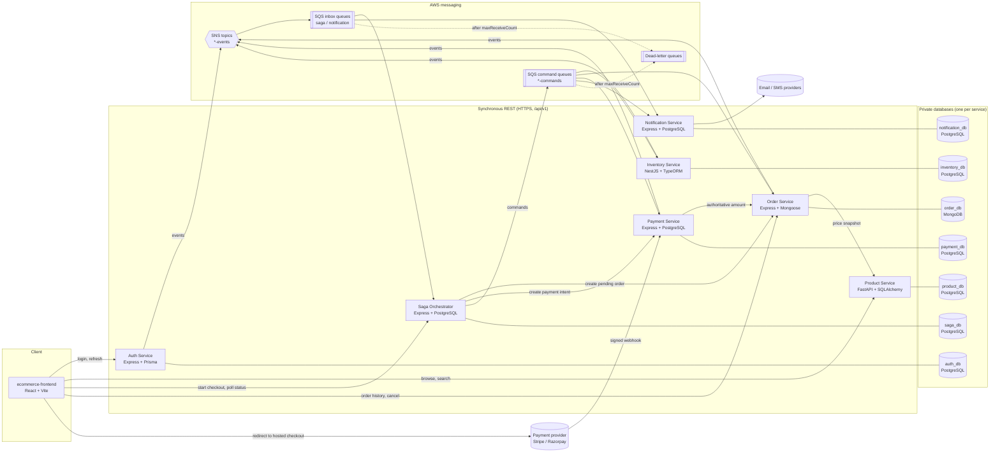
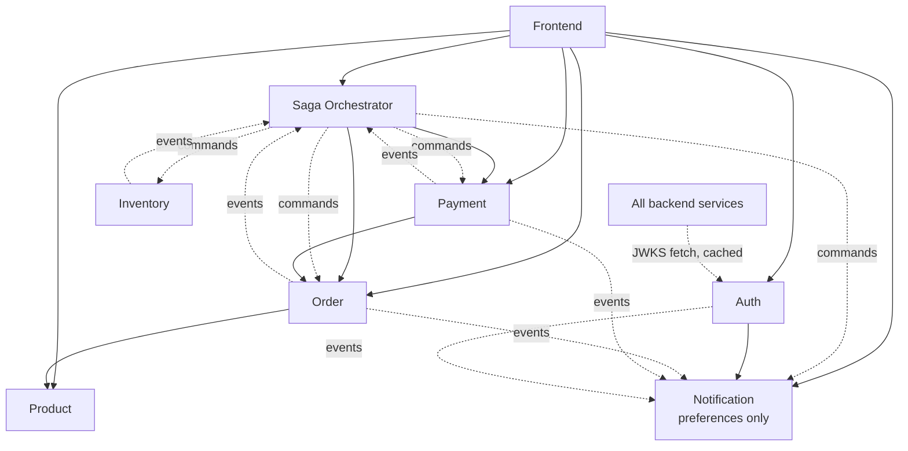
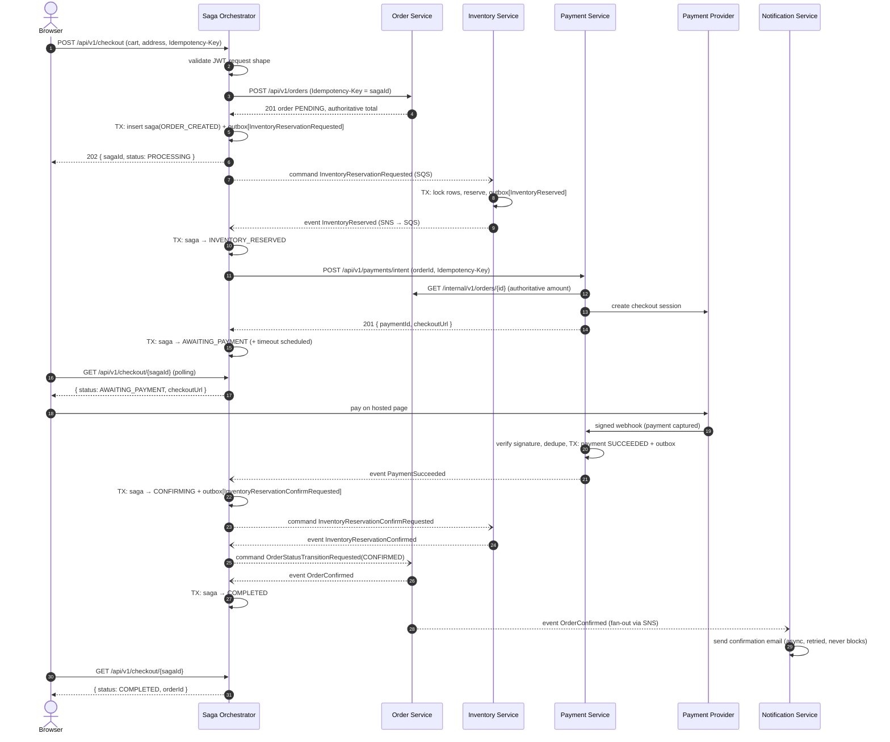
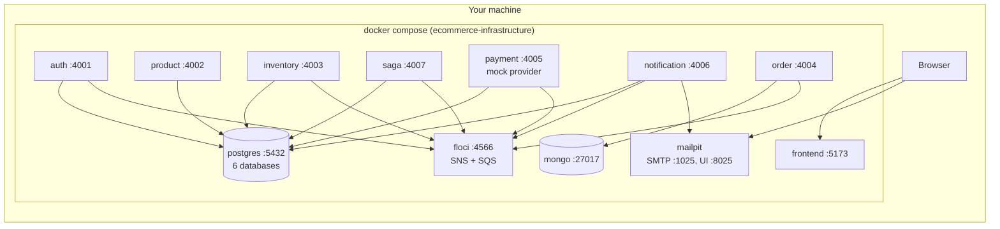

# E-commerce Platform Architecture

This document is the platform-level view of the system. It lives in
`ecommerce-infrastructure` because this repository owns the cross-service
runtime topology (messaging, networking, local orchestration). Each service
repository owns its own API and event documentation.

Related documents:

- [conventions.md](conventions.md): IDs, headers, money, time, errors, event envelope
- [messaging-topology.md](messaging-topology.md): SNS topics, SQS queues, DLQs, filter policies
- [checkout-saga.md](checkout-saga.md): checkout workflow, failure handling, compensation
- [local-development.md](local-development.md): Docker Compose environment and ports
- [implementation-checklist.md](implementation-checklist.md): phase-by-phase checklist

---

## 1. Architecture diagram

Every service validates access tokens locally using the Auth Service's public keys (JWKS). Nothing calls
the Auth Service on every request. Service-to-service calls use short-lived tokens from Auth's
client-credentials grant whose audience names the ONE target service, so a token Order obtained for Product
is rejected by Inventory. See [conventions.md §Authentication](conventions.md#authentication).

---

## 2. Repository responsibility matrix

| # | Repository | Stack | Owns (source of truth) | Does NOT own |
|---|---|---|---|---|
| 1 | `ecommerce-auth-service` | Express, TS, Prisma, PostgreSQL | Users, credentials, roles, sessions, refresh tokens, auth audit log, JWT signing keys | Profiles/addresses (later: customer data in frontend-facing profile API), notifications |
| 2 | `ecommerce-product-service` | FastAPI, SQLAlchemy 2, Alembic, PostgreSQL | Catalog, categories, variants, SKUs, slugs, images, **catalog prices** | Stock levels, order prices once placed |
| 3 | `ecommerce-inventory-service` | NestJS, TypeORM, PostgreSQL | Available/reserved stock per SKU, reservations, stock audit history | Prices, product descriptions |
| 4 | `ecommerce-order-service` | Express, TS, Mongoose, MongoDB | Orders, immutable line-item snapshots, totals, order status & history | Payment status details, stock |
| 5 | `ecommerce-saga-orchestrator` | Express, TS, PostgreSQL, SNS/SQS | Checkout saga instances, step history, outbox, timeouts, manual-review queue | Any business entity (it only coordinates) |
| 6 | `ecommerce-payment-service` | Express, TS, PostgreSQL | Payment attempts, provider references, webhook log, refunds, reconciliation | Order totals (reads them from Order Service) |
| 7 | `ecommerce-notification-service` | Express, TS, PostgreSQL, SNS/SQS | Templates, preferences, delivery records, retry schedule | Business state of anything it notifies about |
| 8 | `ecommerce-frontend` | React, Vite, TS, Tailwind | UI state, cart draft (non-authoritative) | Prices, stock, payment status, authorization |
| 9 | `ecommerce-infrastructure` | Terraform, Docker Compose, GitHub Actions | AWS topology, IAM, alarms, local environment, platform docs | Application code |
| 10 | `ecommerce-contracts` | OpenAPI, JSON Schema, AsyncAPI | Published, versioned API and message contracts; compatibility checks; ownership matrix | Implementation code |

---

## 3. Service dependency map

Arrows read "depends on". **Solid** = synchronous call (the caller fails or
degrades if the callee is down). **Dashed** = asynchronous (the caller keeps
working, and messages wait in the queue).

Design rules that come out of this map:

1. **No cycles of synchronous calls.** Order → Product and Payment → Order are
   one-directional. Inventory makes no synchronous outbound calls at all.
2. **Inventory is driven only by commands and admin REST calls.** It never calls
   Order or Payment, so it stays the simplest service to keep correct.
3. **Synchronous calls are used only where the caller needs an immediate answer
   to continue:**
   - Saga → Order `POST /orders`: the saga needs the order ID and the
     authoritative total.
   - Saga → Payment `POST /payments/intent`: the browser needs a checkout
     session to redirect to.
   - Order → Product: to snapshot current prices when the order is created.
   - Payment → Order: to read the authoritative amount, never trusting the caller.
   - Order → Auth `POST /internal/v1/auth/service-token`: client-credentials grant (cached ~4 min).
   - Auth → Notification: to deliver password-reset and verification links.
     These secrets must never travel through queues or logs. See
     [checkout-saga.md](checkout-saga.md) and the Auth Service README.
4. **Every synchronous call carries an `Idempotency-Key`**, so the saga can retry
   safely after a timeout without creating duplicates.

---

## 4. Database ownership plan

| Service | Engine | Local database / role | Key tables / collections | Migration tool |
|---|---|---|---|---|
| Auth | PostgreSQL 17 | `auth_db` / `auth_svc` | `users`, `sessions`, `refresh_tokens`, `email_verification_tokens`, `password_reset_tokens`, `auth_audit_log`, `outbox` | Prisma Migrate |
| Product | PostgreSQL 17 | `product_db` / `product_svc` | `categories`, `products`, `product_variants`, `product_images`, `product_specifications` | Alembic |
| Inventory | PostgreSQL 17 | `inventory_db` / `inventory_svc` | `stock_items`, `reservations`, `reservation_lines`, `stock_movements`, `processed_messages`, `outbox` | TypeORM migrations |
| Order | MongoDB 8 | `order_db` / `order_svc` | `orders`: one document per order with embedded items, status history **and pending outbox events** | Index sync job (`syncIndexes`); versioned data-migration scripts when needed |
| Saga | PostgreSQL 17 | `saga_db` / `saga_svc` | `saga_instances`, `saga_steps`, `outbox`, `processed_messages`, `scheduled_timeouts` | node-pg-migrate |

**Why Order embeds its outbox.** MongoDB is atomic per document. Embedding status history and pending
events in the order lets every state change be ONE conditional `findOneAndUpdate` (compare-and-set on
status and version). No multi-document transaction is needed, so no replica set either. The Postgres services
get the same guarantee from a database transaction spanning the business table and the `outbox` table.

**Migrations run as one-off jobs, never at service startup.** Each service image has a `migrate` target
(Prisma / Alembic / TypeORM / Mongo index sync). Compose runs `<service>-migrate` to completion before
starting the service. In ECS this becomes a one-off task per deploy, so replicas never race to migrate.
| Payment | PostgreSQL 17 | `payment_db` / `payment_svc` | `payments`, `payment_attempts`, `webhook_events`, `refunds`, `outbox`, `processed_messages` | node-pg-migrate |
| Notification | PostgreSQL 17 | `notification_db` / `notification_svc` | `templates`, `preferences`, `notifications`, `delivery_attempts`, `processed_messages` | node-pg-migrate |

Rules:

- **One database and one role per service.** Locally, the Postgres databases
  share a single server container to save memory. The init script revokes
  `CONNECT` from `PUBLIC`, so `order_svc` *cannot* connect to `auth_db`, even
  by mistake. In AWS, each service gets its own RDS instance (or at least its
  own database and Secrets Manager secret).
- **Data needed from another service is fetched through its API or kept as a
  local copy built from its events.** Example: Order stores a *snapshot* of the
  product name and price at purchase time. It never joins against
  `product_db`.
- **Money:** integer minor units (`amountMinor: 49900` + `currency: "INR"`) in
  every database, API and event. PostgreSQL columns are `BIGINT`. MongoDB uses
  `NumberLong` / `Int64`.
- **Time:** stored as `timestamptz` (Postgres) or BSON `Date` (Mongo), always UTC.
- **The ORM choice is per service.** Payment, Saga and Notification use plain
  SQL through `pg` with node-pg-migrate. Their schemas are small and
  correctness-critical (outbox, row locks), so explicit SQL is easier to reason
  about than an ORM.

---

## 5. Checkout saga sequence

Full detail, including every failure branch, is in [checkout-saga.md](checkout-saga.md).

Why the browser's "payment success" redirect proves nothing: the redirect URL
can be typed by hand. Only the **signed webhook** (or a server-side status query
to the provider during reconciliation) moves a payment to `SUCCEEDED`.

---

## 6. Local development architecture

Details and commands are in [local-development.md](local-development.md).

- Each service's build context is a **sibling repository directory**, which you
  can override with an environment variable (`AUTH_SERVICE_PATH=../somewhere`).
- [Floci](https://floci.io) emulates SNS and SQS (it replaced LocalStack in Phase 3). The *same* Terraform
  messaging module that targets AWS is applied to Floci (`terraform/environments/local`), so
  the local topology matches the real one.
- The Payment Service runs with `PAYMENT_PROVIDER=mock`. The mock provider
  exposes a fake hosted-checkout page and sends correctly **signed** webhooks,
  so the signature-verification code path is exercised locally too.
- Mailpit captures all outgoing email at <http://localhost:8025>.
- Every service can *also* run on its own: each repo has a `compose.yaml`
  that starts only its own database.

---

## 7. API and message contracts

**Phases 1–5:** each service repository was the source of truth for its own contracts (`docs/api.md`,
`openapi/`, `events/schemas`), and the envelope schema was copied into six repositories by hand. By Phase 6 the
copies had drifted (in `$id`), and one schema still named a queue that had become FIFO.

**From Phase 6:** [`ecommerce-contracts`](../../../ecommerce-contracts) publishes them.

| Contract | Source of truth | Flow |
|---|---|---|
| Messages (JSON Schema 2020-12) | `ecommerce-contracts/schemas/<owner>/` | **contract-first**: changed there, released (tag), then vendored into producers and consumers |
| Envelope | `ecommerce-contracts/schemas/common/` | one copy |
| HTTP APIs (OpenAPI) | each service's code (generated, drift-tested in the service) | **code-first**: republished with `npm run sync:openapi`, released |
| AsyncAPI, ownership matrix | generated in ecommerce-contracts | `npm run build` |

- **Ownership:** an event belongs to its producer, a command to its consumer (enforced by tests).
- **Compatibility:** `npm run compat` judges every change from the side that did not make it and enforces the
  version bump; breaking changes go expand → migrate → contract (`VERSIONING.md`).
- **Pinning:** services vendor a release into `events/` (or `contracts/openapi` in the frontend) with
  `contracts.lock.json`; a test in each service fails on hand edits.
- **Contract tests in consumers:** the saga checks that producers *require* the fields it relies on and that
  every command it builds validates against the receiver's schema; the Notification Service runs every producer
  example through its handler; the frontend's typecheck asserts each API response type it reads.
- **Tolerant readers:** consumers still validate only what they use (adding optional fields is not breaking).

## 8. Implementation checklist

See [implementation-checklist.md](implementation-checklist.md).
