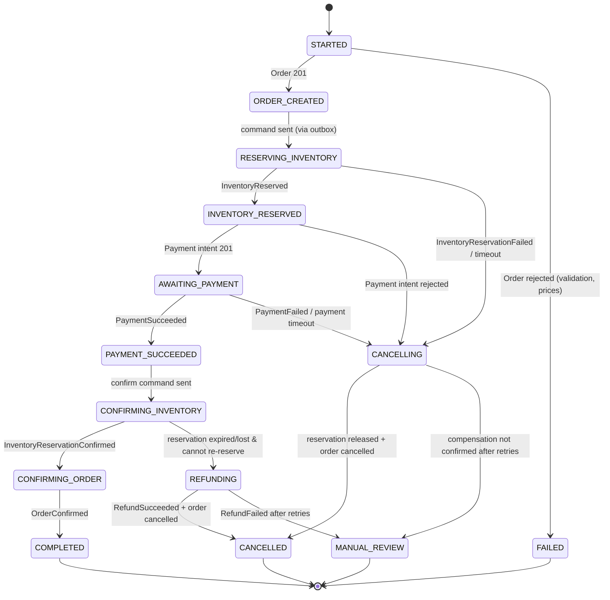

# Checkout Saga

## Why a saga at all?

Checkout touches three databases (orders, inventory and payments) owned by three
services. There is no distributed transaction across them. Two-phase commit
would couple their availability and is not supported by SQS or by payment
providers anyway. A **saga** replaces one big transaction with a series of local
transactions. Each step has a **compensating action** that semantically undoes
it if a later step fails.

We use **orchestration** (one coordinator that tells others what to do) rather
than **choreography** (each service reacting to others' events). In
orchestration, the workflow is readable in one place, timeouts have an owner,
and "where is checkout X stuck?" has a single answer: the `saga_instances` row.

## Saga state machine

Each transition is a single database transaction in `saga_db` that:

1. checks the current state (optimistic `version` column),
2. writes the new state plus a `saga_steps` history row,
3. writes any outgoing commands to the `outbox` table,
4. records the incoming `messageId` in `processed_messages`.

**State is persisted *before* the next action is triggered**, because the outbox
relay publishes only committed rows.

## Order status mapping

| Saga state | Order status (set by saga command) |
|---|---|
| ORDER_CREATED | `PENDING` |
| RESERVING_INVENTORY | `INVENTORY_RESERVING` |
| INVENTORY_RESERVED | `INVENTORY_RESERVED` |
| AWAITING_PAYMENT | `PAYMENT_PENDING` |
| PAYMENT_SUCCEEDED | `PAYMENT_SUCCEEDED` |
| COMPLETED | `CONFIRMED` |
| CANCELLED | `CANCELLED` (or `FAILED` when nothing was ever reserved) |
| REFUNDING | `REFUND_PENDING` → `REFUNDED` |

`PROCESSING`, `SHIPPED` and `DELIVERED` are fulfillment states, set later by
admin actions, outside the checkout saga.

## Failure handling

| Failure | Detected by | Action |
|---|---|---|
| Inventory unavailable | `InventoryReservationFailed` | Order → `CANCELLED` (reason `OUT_OF_STOCK`). Saga → `CANCELLED` |
| No reservation reply | Timeout (default 30s) | Send `InventoryReservationReleaseRequested` (harmless if nothing was reserved, because release is idempotent), then cancel the order |
| Payment fails | `PaymentFailed` | Release reservation, order → `CANCELLED`, notify customer |
| Customer never pays | Payment timeout (default 30 min, shorter than the reservation TTL of 45 min) | Ask Payment to expire the session. Then release and cancel. A late `PaymentSucceeded` after cancellation triggers `RefundRequested` |
| Payment succeeds, confirm fails transiently | Command retry / redelivery | Retry with the same `idempotencyKey` and exponential backoff |
| Payment succeeds, reservation expired | `InventoryReservationFailed{reason: RESERVATION_EXPIRED}` | Try to re-reserve. If stock is gone, `RefundRequested`, then order → `REFUND_PENDING` |
| Refund fails or is unconfirmed | `RefundFailed` / timeout | Retry. Then `MANUAL_REVIEW` with `SagaManualReviewRequired` event and alert |
| Saga process crashes mid-flow | On restart, the recovery job scans non-terminal sagas past their `nextActionAt` | Re-issue the pending step (idempotent) |
| Duplicate message | `processed_messages` unique constraint | Acknowledge and skip |

**Publishing a command is not success.** The saga moves forward only when the
*result event* arrives. Every waiting state has a timeout row in
`scheduled_timeouts`.

## Reconciliation jobs

- **Saga recovery:** every minute, resume sagas whose `nextActionAt < now()`.
- **Payment reconciliation:** the Payment Service queries the provider for
  payments in `PROCESSING` for more than 10 minutes.
- **Reservation expiry:** Inventory releases expired *unconfirmed* reservations
  and emits `InventoryReservationReleased{reason: EXPIRED}`.

## Secrets never travel through the saga

Password-reset and email-verification links contain secrets. The Auth Service
sends them to the Notification Service via a **synchronous internal REST call**
(`POST /internal/v1/notifications/transactional`) over TLS. The secret is used
only to render the message and is never persisted, logged, or put on a queue.
If delivery fails, the user simply requests a new link.
