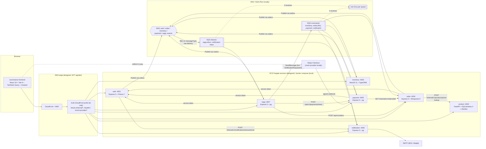
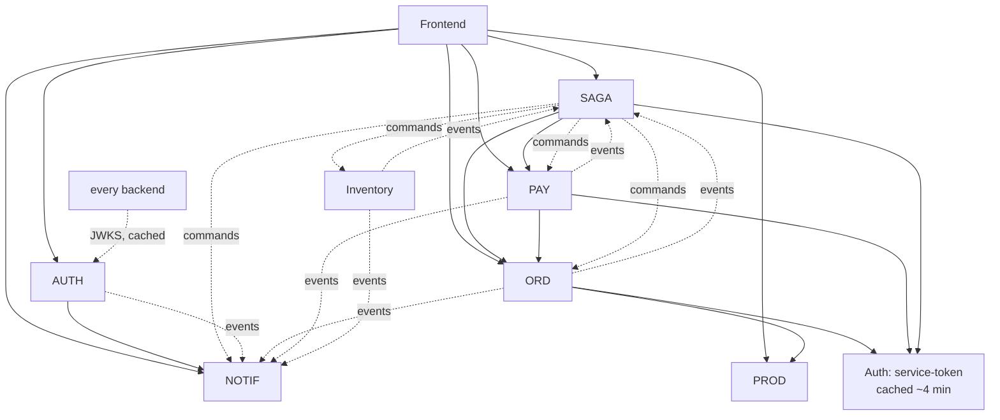

# Phase A.1: System Architecture, Repositories, Dependencies, Data Ownership

All paths are relative to the workspace root. Branch: `phase7`.

---

## 1. System architecture (as implemented)

### Key facts behind the diagram (with evidence)

| Fact | Evidence |
|---|---|
| Every service verifies user JWTs **locally** with Auth's JWKS (RS256 only) | [token-service.ts:51-57](ecommerce-auth-service/src/security/token-service.ts#L51-L57), [product security.py](ecommerce-product-service/app/security.py) (`algorithms=["RS256"]`, JWKS cached 600 s) |
| Service-to-service calls use OAuth2 client-credentials tokens with a **per-target audience**, 300 s TTL | [service-token.ts:34-61](ecommerce-auth-service/src/modules/internal/service-token.ts#L34-L61) |
| Commands go **directly to an SQS queue**; events go to **SNS then fan out** to subscriber queues | [saga outbox-relay.ts:95-111](ecommerce-saga-orchestrator/src/messaging/outbox-relay.ts#L95-L111) |
| SNS→SQS subscriptions use **raw delivery** and filter on the `messageType` attribute | [messaging/main.tf:149-151](ecommerce-infrastructure/terraform/modules/messaging/main.tf#L149-L151) |
| Only `order-commands` is FIFO (`MessageGroupId = orderId`) | [messaging/main.tf:15](ecommerce-infrastructure/terraform/modules/messaging/main.tf#L15), [saga outbox-relay.ts:102-109](ecommerce-saga-orchestrator/src/messaging/outbox-relay.ts#L102-L109) |
| Nothing is published inside a request: every service writes an **outbox** row/entry in its business transaction | e.g. [inventory reservation.service.ts:158-163](ecommerce-inventory-service/src/inventory/reservation.service.ts#L158-L163) |
| The AWS edge (CloudFront, WAF, ALB, ECS) is **designed only** | [deployment.md](ecommerce-infrastructure/docs/architecture/deployment.md): "Nothing has been applied" |

---

## 2. Repository responsibility matrix

| Repo | Business responsibility | Stack | Entry point | DB / migrations | Messaging | Tests (dir) | Status |
|---|---|---|---|---|---|---|---|
| `ecommerce-auth-service` | Users, passwords (Argon2id), sessions, rotating refresh tokens, JWT signing + JWKS, service tokens, audit log | Node 24, TS, Express 5, Prisma 7, Zod 4, jose 6 | `src/server.ts` | PostgreSQL `auth_db`; Prisma Migrate (`prisma/migrations`, 2 migrations) | Publishes `UserRegistered`, `UserEmailVerified` (outbox) | `tests/` (Vitest, 10 test files) | Implemented |
| `ecommerce-product-service` | Catalog, categories, variants/SKUs, prices, search (full-text + `pg_trgm`) | Python 3.14, FastAPI, SQLAlchemy 2, Alembic, Pydantic 2, PyJWT | `app/__main__.py` → `app/main.py` | PostgreSQL `product_db`; Alembic (2 revisions) | **None** (`MESSAGING_ENABLED=false`) | `tests/` (pytest, 6 test files) | Implemented |
| `ecommerce-inventory-service` | Stock per SKU, all-or-nothing reservations, confirm/release/return, expiry sweeper, stock movements | NestJS 11, TypeORM, jose 5 | `src/main.ts` | PostgreSQL `inventory_db`; TypeORM migrations (3) | Consumes `inventory-commands`; publishes `inventory-events` | `test/` (Jest + ts-jest, 7 spec files) | Implemented |
| `ecommerce-order-service` | Orders, immutable price snapshot, totals/tax/coupons, status state machine, cancellation | Express 5, Mongoose 9 | `src/server.ts` | MongoDB `order_db` (outbox **embedded** in each order); `syncIndexes` job | Consumes `order-commands.fifo`; publishes `order-events` | `tests/` (Vitest, 10 test files) | Implemented; DocumentDB untested (S-12) |
| `ecommerce-saga-orchestrator` | Checkout saga: state, timeouts, compensation, recovery, manual review, per-customer checkout limit | Express 5, raw `pg`, node-pg-migrate | `src/server.ts` | PostgreSQL `saga_db` (1 SQL migration) | Consumes `saga-inbox`; sends to 4 command queues; publishes `saga-events` | `tests/` (Vitest, 8 test files) | Implemented |
| `ecommerce-payment-service` | Payments, hosted checkout (Stripe / mock), signed webhooks, refunds, reconciliation | Express 5, raw `pg`, Stripe SDK | `src/server.ts` | PostgreSQL `payment_db` (1 SQL migration) | Consumes `payment-commands`; publishes `payment-events` (IAM allows `NotificationRequested`, but the code never sends it) | `tests/` (Vitest, 7 test files) | Implemented (Stripe adapter tested offline only) |
| `ecommerce-notification-service` | Recipients projection, preferences, email/SMS delivery with retry and jitter, DLQ monitor, transactional (secret-bearing) mail | Express 5, raw `pg`, SMTP | `src/server.ts` | PostgreSQL `notification_db` (1 SQL migration) | Consumes `notification-commands` + `notification-inbox` | `tests/` (Vitest, 9 test files) | Implemented |
| `ecommerce-frontend` | Shop UI, cart (non-authoritative), checkout polling, account and admin pages | React 19, Vite 8, React Router 8, TanStack Query 5, Zustand, Playwright | `src/main.tsx` | none | none | `src/test/` (Vitest + RTL), `e2e/` (Playwright) | Implemented |
| `ecommerce-infrastructure` | Compose stack, Terraform (8 modules + 4 environments), workflow templates, verification scripts, platform docs, runbooks | Terraform 1.16.2, AWS provider 6.6x, Compose, Python scripts | `compose.yaml`, `terraform/environments/*` | `local/postgres/init.sql` (role + DB per service) | Defines the whole SNS/SQS topology | `terraform/modules/*/tests/*.tftest.hcl` (mocked provider) | Local applied (Floci); AWS **not applied** |
| `ecommerce-contracts` | Versioned JSON Schemas (events/commands), envelope, OpenAPI copies, AsyncAPI, compatibility checker, vendoring | Node, Ajv, Vitest | `scripts/*.mjs`, `lib/compat.mjs` | n/a | Source of truth for 28 message schemas (events + commands) + envelope | `tests/` (2 files) | Implemented; **no remote** |

### HTTP surface (from each service's `openapi/openapi.json`)

| Service | Public `/api/v1` | Internal `/internal/v1` (blocked at ALB) |
|---|---|---|
| Auth | register, login, refresh, logout(-all), verify-email(+resend), forgot/reset-password, me, admin users | `POST /auth/service-token` |
| Product | categories CRUD, products CRUD, by-slug, variants | `POST /products/price-lookup` |
| Inventory | reservations (create/get/confirm/release), stock list/get/patch, low-stock, movements | — |
| Order | create/list orders, my-orders, get, cancel, admin list/status | `GET /orders/{id}`, `POST /orders/{id}/transitions` |
| Payment | intent (service role), checkout (reopen), get, **webhooks/{provider}**, refund (admin), admin list | — |
| Notification | preferences, history, admin list/dead-letters/retry | `POST /notifications/transactional` |
| Saga | `POST /checkout`, `GET /checkout/{sagaId}`, admin sagas list/get/retry/resolve | — |

Note: `POST /api/v1/payments/intent` requires the `service` role but sits under a **public** path prefix. Only the
role check protects it, not the network ([routes.ts:39](ecommerce-payment-service/src/api/routes.ts#L39)). That works, but it
is the one service-only endpoint not under `/internal`. Revisit in Phase E.

---

## 3. Service dependency map

Solid = synchronous HTTP (caller blocks or degrades). Dashed = asynchronous (messages wait in a queue).

**Synchronous chains (the availability coupling that actually exists):**

- `Browser → Saga → Order → Product`: starting checkout needs all three up. If Order or Product is down, the
  saga stays `STARTED` and retries with backoff 1 s, 2 s, 4 s … (max 5 attempts, then `FAILED`)
  ([decide.ts:25-26](ecommerce-saga-orchestrator/src/saga/decide.ts#L25-L26), [decide.ts:391-403](ecommerce-saga-orchestrator/src/saga/decide.ts#L391-L403)).
- `Saga → Payment → Order`: creating the payment intent needs both. Payment reads the **amount from Order**,
  never from the caller ([payment-service.ts:115-126](ecommerce-payment-service/src/payments/payment-service.ts#L115-L126)).
- `Auth → Notification`: password-reset and verification mail. It is synchronous **on purpose**, so the secret link
  never sits in a queue.
- No cycles. Inventory makes **no** outbound HTTP calls.

**Independently deployable?** Yes, each repo has its own CI/CD, image, database and pinned contract version. What
still needs **integration testing**: the saga against the real Inventory/Order/Payment behavior (done by
`ecommerce-infrastructure/scripts/verify-*.py` and the nightly `e2e.yml`), contract changes (compat check), and
queue/filter-policy routing (`verify-local-messaging.sh`).

---

## 4. Database ownership and migrations

| Service | Engine | Tables / collections (from the migrations, not the docs) | Migration tool and command | Runs as |
|---|---|---|---|---|
| Auth | PostgreSQL 17 | `User`, `Session`, `RefreshToken`, `EmailVerificationToken`, `PasswordResetToken`, `AuthAuditLog`, `OutboxMessage` ([schema.prisma](ecommerce-auth-service/prisma/schema.prisma)) | Prisma Migrate: `prisma migrate deploy` (prod/CI), `prisma migrate dev` (local authoring only), drift check `prisma migrate diff … --exit-code` | `auth-migrate` image target |
| Product | PostgreSQL 17 | `categories`, `products` (GIN `search_vector`, trigram `name`), `product_variants`, `product_images`, `product_specifications` | Alembic: `alembic upgrade head`; CI round-trips `downgrade base` and runs `alembic check` | `migrate` target |
| Inventory | PostgreSQL 17 | `stock_items` (CHECK `reserved <= on_hand`, both ≥ 0), `reservations` (partial unique: one live reservation per order), `reservation_lines`, `stock_movements`, `idempotency_records`, `outbox` | TypeORM: `migration:run` / `migration:revert`, drift `db:check-drift` | `migrate` target |
| Order | MongoDB 8 (DocumentDB 5 in AWS) | `orders`: one document holds items, totals, `statusHistory[]`, **`outbox[]`**, `version`, `relayLeaseUntil` | `src/scripts/sync-indexes.ts` (Mongoose `syncIndexes`) | `migrate` target |
| Saga | PostgreSQL 17 | `saga_instances` (state enum, `deadline_at`, `lease_until`, `version`, unique `(customer_id, idempotency_key)`), `saga_steps`, `outbox` (`seq`, `group_id`), `processed_messages` | node-pg-migrate (SQL files): `db:migrate`, `db:rollback` | `migrate` target |
| Payment | PostgreSQL 17 | `payments` (unique idempotency key, **unique order_id**, CHECK refund ≤ amount), `refunds` (unique idempotency key, unique provider id), `webhook_events` (unique provider event id = dedupe), `outbox`. **No `processed_messages`**: refund commands dedupe on `refunds.idempotency_key` | node-pg-migrate | `migrate` target |
| Notification | PostgreSQL 17 | `recipients` (projection from Auth events), `preferences`, `notifications` (unique `(dedupe_key, channel)`), `delivery_attempts`, `processed_messages` | node-pg-migrate | `migrate` target |

**Isolation:** locally one Postgres server hosts six databases, but [local/postgres/init.sql](ecommerce-infrastructure/local/postgres/init.sql)
creates one role per service and revokes `CONNECT` from `PUBLIC`. In AWS the design uses **one RDS instance with
six databases** plus one DocumentDB cluster ([data/main.tf:118](ecommerce-infrastructure/terraform/modules/data/main.tf#L118)).
That is cheaper than one RDS instance per service, but it is a shared failure and maintenance domain (see risks file).

**Migrations never run at service startup.** Every image has a `migrate` stage. Compose gates each service on
`<svc>-migrate: service_completed_successfully`. The deploy workflow runs the migrate task and requires exit code 0
before rolling out ([deploy-environment.yml:54-69](ecommerce-auth-service/.github/workflows/deploy-environment.yml#L54-L69)).
This avoids replicas racing to migrate.

### Where the docs and the schema disagree (doc drift, CONFIRMED)

| Doc says ([architecture/README.md §4](ecommerce-infrastructure/docs/architecture/README.md), [checkout-saga.md](ecommerce-infrastructure/docs/architecture/checkout-saga.md)) | Code actually has |
|---|---|
| Saga table `scheduled_timeouts` | No such table. Timeouts are the `saga_instances.deadline_at` column |
| Inventory `processed_messages` | No such table. Dedupe is the unique `reservations.idempotency_key` plus state-based re-answers |
| Payment `payment_attempts`, `processed_messages` | Neither exists. Command dedupe = unique `refunds.idempotency_key` ([refund-command-handler.ts:21-27](ecommerce-payment-service/src/messaging/refund-command-handler.ts#L21-L27)) |
| Notification `templates` table | Templates live in code ([templates.ts](ecommerce-notification-service/src/templates/templates.ts)) |

None of these is a bug; the code's choices are simpler. But the docs teach a design that does not exist.

---

## 5. Cross-cutting conventions you will see everywhere

| Convention | Where | Why it matters |
|---|---|---|
| Money = integer minor units + ISO currency (`amountMinor: 49900, currency: "INR"`), `BIGINT` / `BigInt` | all services | No floating-point rounding errors in totals or refunds |
| IDs = UUIDv7 | `uuid` v7 everywhere | Time-ordered, so keyset pagination (`id < cursor`) and index locality work |
| Errors = RFC 9457 `application/problem+json` with `code` | each `lib/problem.ts` | The frontend maps `code` to a message ([checkout.ts:56-68](ecommerce-frontend/src/checkout/checkout.ts#L56-L68)) |
| `Idempotency-Key` header and request hash; key reuse with a different body → 422 `IDEMPOTENCY_KEY_REUSED` | saga, order, inventory, payment | A retry after a timeout cannot create a second order, reservation, or charge |
| Message envelope: `messageId, messageKind, messageType, messageVersion, producer, occurredAt, correlationId, causationId, sagaId, idempotencyKey, payload` | [contracts envelope.v1.schema.json](ecommerce-contracts/schemas/common/envelope.v1.schema.json) | Dedupe (`messageId`), tracing (`correlationId`/`causationId`), routing (`sagaId`) |
| Tolerant reader: consumers validate only fields they use | [inbox-consumer.ts:10-17](ecommerce-saga-orchestrator/src/messaging/inbox-consumer.ts#L10-L17) | Producers can add optional fields without breaking consumers |
