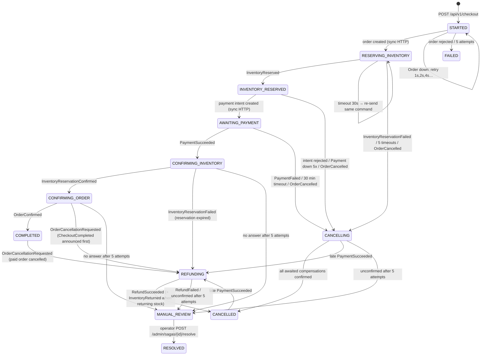

# Phase A.2: The Checkout Saga as Implemented

The saga's rules live in **one pure function**, `decide(saga, input, now, policy) → Decision`
([decide.ts:28-56](ecommerce-saga-orchestrator/src/saga/decide.ts#L28-L56)). No I/O happens there.
[SagaEngine](ecommerce-saga-orchestrator/src/saga/engine.ts) loads and locks the saga, calls `decide`, and
`SagaRepository.apply` persists the new state, a history row and outbox rows **in one transaction**
([repository.ts:147-198](ecommerce-saga-orchestrator/src/saga/repository.ts#L147-L198)). Messages leave only later,
from the outbox relay.

> Glossary
> - **Saga**: a business transaction made of local transactions in several services. Each step has a
>   *compensating action* that semantically undoes it. That is not a database rollback.
> - **Orchestration**: one coordinator (this service) tells the others what to do and owns the timeouts.
> - **Outbox**: a table written in the same DB transaction as the state change. A separate relay publishes it.
>   This removes the "DB committed but the message was lost" gap.

---

## 1. Real state machine (from `types.ts` and `decide.ts`)

States: `STARTED, RESERVING_INVENTORY, INVENTORY_RESERVED, AWAITING_PAYMENT, CONFIRMING_INVENTORY,
CONFIRMING_ORDER, COMPLETED, CANCELLING, REFUNDING, CANCELLED, FAILED, MANUAL_REVIEW, RESOLVED`
([types.ts:1-15](ecommerce-saga-orchestrator/src/saga/types.ts#L1-L15)).



Defaults ([saga env.ts:53-63](ecommerce-saga-orchestrator/src/config/env.ts#L53-L63)): reservation timeout 30 s, payment
timeout 1800 s, step timeout 30 s, `MAX_STEP_ATTEMPTS` 5, `MAX_ACTIVE_CHECKOUTS_PER_CUSTOMER` 3.
Related: Payment `CHECKOUT_EXPIRY_MINUTES` 30 (Stripe's minimum); Inventory reservation TTL 2700 s = 45 min. The
payment window closes **before** the stock hold expires, which is the intended ordering.

**Differences from [checkout-saga.md](ecommerce-infrastructure/docs/architecture/checkout-saga.md) (CONFIRMED):**
the doc's states `ORDER_CREATED` and `PAYMENT_SUCCEEDED` do not exist, and `RESOLVED` exists but is not in the doc.
"Try to re-reserve" after an expired reservation is not implemented: the code refunds directly
([decide.ts:199-214](ecommerce-saga-orchestrator/src/saga/decide.ts#L199-L214)). "Ask Payment to expire the session"
on payment timeout is not implemented either: a TODO comment remains at [decide.ts:155](ecommerce-saga-orchestrator/src/saga/decide.ts#L155).
A payment made after the timeout is caught by the late-payment refund path.

### Customer-visible status

`customerStatus()` collapses internal states into `PROCESSING | AWAITING_PAYMENT | COMPLETED | CANCELLED | FAILED |
UNDER_REVIEW` ([types.ts:117-133](ecommerce-saga-orchestrator/src/saga/types.ts#L117-L133)). Internal states can change
without breaking the frontend.

---

## 2. Happy-path sequence (traced through the code)

```mermaid
sequenceDiagram
    autonumber
    actor U as Browser
    participant S as Saga
    participant O as Order
    participant P as Product
    participant I as Inventory
    participant Y as Payment
    participant G as Stripe / mock
    U->>S: POST /api/v1/checkout + Idempotency-Key (per attempt, sessionStorage)
    S->>S: TX: advisory lock(customer); replay? limit 3; INSERT saga STARTED
    S->>S: lease (60s); NO transaction held during HTTP
    S->>O: POST /api/v1/orders (service token, key derived from saga)
    O->>P: POST /internal/v1/products/price-lookup
    O-->>S: 201 PENDING + authoritative total
    S->>S: TX: → RESERVING_INVENTORY, outbox[OrderStatusTransition(INVENTORY_RESERVING), InventoryReservationRequested]
    S-->>U: 202 {sagaId, status PROCESSING}
    S--)O: (FIFO) INVENTORY_RESERVING
    S--)I: InventoryReservationRequested
    I->>I: TX: claim key; per SKU UPDATE … WHERE on_hand-reserved >= qty; outbox[InventoryReserved]
    I--)S: InventoryReserved (SNS → saga-inbox)
    S->>S: TX: dedupe messageId; → INVENTORY_RESERVED (deadline = now)
    S->>Y: POST /api/v1/payments/intent
    Y->>O: GET /internal/v1/orders/{id} (amount + status must be payable)
    Y->>G: create checkout session (provider idempotency key checkout:{paymentId})
    Y-->>S: 201 {paymentId, checkoutUrl}
    S->>S: TX: → AWAITING_PAYMENT (deadline +30 min)
    U->>S: GET /api/v1/checkout/{sagaId} (polling)
    U->>G: pay on the hosted page (URL must pass safePaymentUrl allowlist)
    G->>Y: signed webhook
    Y->>Y: verify HMAC on raw body (5 min window) → TX: insert webhook_events (dedupe) + SUCCEEDED + outbox[PaymentSucceeded]
    Y--)S: PaymentSucceeded
    S--)O: PAYMENT_SUCCEEDED
    S--)I: InventoryReservationConfirmRequested
    I--)S: InventoryReservationConfirmed (on_hand and reserved both decremented)
    S--)O: CONFIRMED
    O--)S: OrderConfirmed
    S->>S: → COMPLETED, outbox[CheckoutCompleted]
```

Code anchors, step by step:

| Step | Code |
|---|---|
| Idempotent start + per-customer limit (advisory lock makes count-then-insert atomic) | [repository.ts:80-115](ecommerce-saga-orchestrator/src/saga/repository.ts#L80-L115), [engine.ts:58-82](ecommerce-saga-orchestrator/src/saga/engine.ts#L58-L82) |
| Sync step with lease; result applied only if `version` unchanged | [engine.ts:120-138](ecommerce-saga-orchestrator/src/saga/engine.ts#L120-L138) |
| Order price snapshot and idempotent create | [order.service.ts:75-174](ecommerce-order-service/src/orders/order.service.ts#L75-L174) |
| No-oversell reservation (check and act in ONE statement, SKU-ordered locks, savepoint for all-or-nothing) | [reservation.service.ts:79-176](ecommerce-inventory-service/src/inventory/reservation.service.ts#L79-L176) |
| Inbound event: lock saga, dedupe, decide, persist in ONE transaction | [engine.ts:90-111](ecommerce-saga-orchestrator/src/saga/engine.ts#L90-L111) |
| Amount taken from Order, never from the caller | [payment-service.ts:103-148](ecommerce-payment-service/src/payments/payment-service.ts#L103-L148) |
| Webhook verify → dedupe → apply | [payment-service.ts:216-238](ecommerce-payment-service/src/payments/payment-service.ts#L216-L238), [signature.ts:17-27](ecommerce-payment-service/src/providers/signature.ts#L17-L27) |
| Order CAS on `(status, version)` | [order.service.ts:220-258](ecommerce-order-service/src/orders/order.service.ts#L220-L258) |

---

## 3. Failure and compensation paths

"Compensation" is a **new business action** (release stock, cancel order, refund money). It does not roll back
another service's database. A refund is a new money movement with its own failure modes.

| Failure | What the code does | Evidence | Verified by a test that exists |
|---|---|---|---|
| Inventory reservation fails (out of stock / unknown SKU) | Inventory commits a `REJECTED` reservation and emits `InventoryReservationFailed`. Saga → `CANCELLING`, cancels the order only (nothing reserved) | [reservation.service.ts:128-146](ecommerce-inventory-service/src/inventory/reservation.service.ts#L128-L146), [decide.ts:121-125](ecommerce-saga-orchestrator/src/saga/decide.ts#L121-L125) | `saga-flows.test.ts` "out of stock → order cancelled → CANCELLED" |
| Reservation answer lost | Timeout re-sends the **same** command (key `{sagaId}:reserve`) up to 5×, then releases **by order id** | [decide.ts:98-111](ecommerce-saga-orchestrator/src/saga/decide.ts#L98-L111), [inventory-command-handler.ts:80-90](ecommerce-inventory-service/src/messaging/inventory-command-handler.ts#L80-L90) | "lost reservation answer → the SAME command is re-sent…" |
| Payment fails | Release stock **and** cancel the order. `CANCELLED` only after **both** confirmations arrive | [decide.ts:171-178](ecommerce-saga-orchestrator/src/saga/decide.ts#L171-L178), [decide.ts:269-305](ecommerce-saga-orchestrator/src/saga/decide.ts#L269-L305) | "payment failed → … CANCELLED only after BOTH are confirmed" |
| Customer never pays | 30 min timeout → release + cancel | [decide.ts:154-162](ecommerce-saga-orchestrator/src/saga/decide.ts#L154-L162) | "payment never arrives → timeout → compensation" |
| Payment succeeds **after** cancellation | "Money truth wins": Payment records success even for an EXPIRED/FAILED payment; saga → `REFUNDING` with reason `LATE_PAYMENT_AFTER_CANCELLATION` | [payment-service.ts:276-286](ecommerce-payment-service/src/payments/payment-service.ts#L276-L286), [decide.ts:31-34](ecommerce-saga-orchestrator/src/saga/decide.ts#L31-L34), [decide.ts:307-327](ecommerce-saga-orchestrator/src/saga/decide.ts#L307-L327) | "a payment arriving after cancellation is refunded" |
| Payment succeeds but the HTTP response (intent) is lost | Saga retries `createIntent` with the same key; Payment returns the existing row and finishes the provider session with the provider idempotency key `checkout:{paymentId}` | [payment-service.ts:108-147](ecommerce-payment-service/src/payments/payment-service.ts#L108-L147) | "instance died while holding the payment-intent lease…" |
| Webhook lost | Reconciliation every 60 s asks the provider about payments `PENDING` longer than 300 s | [payment-service.ts:419-467](ecommerce-payment-service/src/payments/payment-service.ts#L419-L467) | payments tests (reconciliation) |
| Event delivered twice (same `messageId`) | `processed_messages` insert `ON CONFLICT DO NOTHING` in the same TX → skip | [repository.ts:135-141](ecommerce-saga-orchestrator/src/saga/repository.ts#L135-L141) | "a redelivered event (same messageId) is dropped…" |
| Duplicate answer with a **new** `messageId` (a service re-emitted) | `decide` ignores it by state ("not awaiting X") | [decide.ts:280](ecommerce-saga-orchestrator/src/saga/decide.ts#L280) | "a duplicate answer with a NEW messageId … is ignored by state" |
| Inventory confirm fails after payment (reservation expired) | Saga → `REFUNDING` (`OUT_OF_STOCK_AFTER_PAYMENT`), order → `REFUND_PENDING` → `REFUNDED` | [decide.ts:199-214](ecommerce-saga-orchestrator/src/saga/decide.ts#L199-L214) | decide test "paid but the reservation expired → REFUNDING…" |
| Inventory confirm never answers | Re-send up to 5×, then `MANUAL_REVIEW` (never silently cancels a paid order) + customer email `order.under-review` | [decide.ts:183-190](ecommerce-saga-orchestrator/src/saga/decide.ts#L183-L190), [decide.ts:375-389](ecommerce-saga-orchestrator/src/saga/decide.ts#L375-L389) | "paid but confirmation never answers…" |
| Refund fails / times out | `RefundFailed` → `MANUAL_REVIEW` immediately. No answer → re-send 5× with the same key `{sagaId}:refund`, then review. Payment never refunds twice for one key, and caps refunds at paid − refunded − pending | [decide.ts:279](ecommerce-saga-orchestrator/src/saga/decide.ts#L279), [payment-service.ts:305-338](ecommerce-payment-service/src/payments/payment-service.ts#L305-L338) | "refund failure → MANUAL_REVIEW; an operator resolves it" |
| A service is unavailable (sync) | Order down: `STARTED` retries with backoff, then `FAILED`. Payment down: `INVENTORY_RESERVED` retries, then compensates | [decide.ts:91-92](ecommerce-saga-orchestrator/src/saga/decide.ts#L91-L92), [decide.ts:140-144](ecommerce-saga-orchestrator/src/saga/decide.ts#L140-L144) | "Order Service down: STARTED retries…" |
| A service is unavailable (async) | Commands wait in SQS; the saga's timeouts re-send and eventually escalate | consumers' delete-after-success | messaging tests (Floci) |
| Consumer crashes before deleting the SQS message | Message becomes visible again after the visibility timeout (60 s) → reprocessed; handlers are idempotent and **re-answer** | [command-consumer.ts:90-111](ecommerce-inventory-service/src/messaging/command-consumer.ts#L90-L111) | Floci messaging tests |
| DB commits but publish fails | Row stays in the outbox, relay retries. At-least-once: a crash after send but before marking re-sends it | [outbox-relay.ts:61-93](ecommerce-saga-orchestrator/src/messaging/outbox-relay.ts#L61-L93) | "two relays racing keep each saga's order-commands in send order" |
| Saga process crashes mid-flow | Every non-terminal state has `deadline_at`. On start the saga **drains its inbox for 65 s before judging deadlines**, so a payment made in time is not cancelled by a timeout | [engine.ts:168-198](ecommerce-saga-orchestrator/src/saga/engine.ts#L168-L198), [runner.ts:39-47](ecommerce-saga-orchestrator/src/messaging/runner.ts#L39-L47) | messaging tests "with the startup drain…" / "without it…"; [verify-checkout-saga.py](ecommerce-infrastructure/scripts/verify-checkout-saga.py) SIGKILLs the saga (CLAIM: run locally) |
| Paid order cancelled by the customer | Order → `CANCELLATION_PENDING` + `OrderCancellationRequested`. Saga refunds **first**, then returns the stock (`CONFIRMED → RETURNED`) | [decide.ts:250-266](ecommerce-saga-orchestrator/src/saga/decide.ts#L250-L266), [reservation.service.ts:239-263](ecommerce-inventory-service/src/inventory/reservation.service.ts#L239-L263) | "COMPLETED → refund → REFUNDED + stock returned → CANCELLED…" |

### Paths that can still end badly (details in the risks file)

1. **Pay-and-cancel race** (PLAUSIBLE, no test found). The customer cancels a `PAYMENT_PENDING` order while the
   payment completes, and `PaymentSucceeded` reaches the saga first. The saga moves to `CONFIRMING_INVENTORY`. The
   Order Service acknowledges and drops `PAYMENT_SUCCEEDED`/`CONFIRMED` as invalid transitions
   ([order-command-handler.ts:29-33](ecommerce-order-service/src/messaging/order-command-handler.ts#L29-L33)).
   Inventory **does** confirm, and the later `OrderCancelled` is ignored in `CONFIRMING_*`. Result after about 5 × 30 s:
   `MANUAL_REVIEW` with money taken, the order `CANCELLED`, and stock deducted. It is safe because a human sees it,
   but it is not automatic.
2. **Global outbox stall in the saga** (CONFIRMED code). One permanently failing outbox row blocks every saga
   behind it.
3. **Captured amount ≠ order total**: Payment only logs an error and still marks the payment SUCCEEDED
   ([payment-service.ts:260-263](ecommerce-payment-service/src/payments/payment-service.ts#L260-L263)).
4. **Order created but its response lost, then 5 failed retries**: saga `FAILED` with no cancel command. A `PENDING`
   order can be orphaned. No stock or money is involved.

### Duplicate-charge / oversell analysis (summary)

| Risk | Protection found | Residual |
|---|---|---|
| Duplicate charge | One payment per order (`uq_payments_order`), idempotency keys at saga → payment → provider, frontend reuses one key per checkout attempt | None found in code |
| Duplicate refund | `refunds.idempotency_key` unique, provider key `refund:{refundId}`, CHECK `refunded_minor <= amount_minor`, refundable = paid − refunded − pending | None found |
| Overselling | Conditional `UPDATE … WHERE on_hand - reserved >= qty` + CHECK `reserved <= on_hand` + SKU-ordered locking; concurrent test exists (CLAIM: passes) | None found |
| Lost events | Outbox in every producer; delete-after-success consumers; DLQs | Saga relay head-of-line stall; alarm delivery (see risks) |
| Wrong order state | CAS on `(status, version)`, explicit transition table, FIFO per order | Pay/cancel race → manual review |
