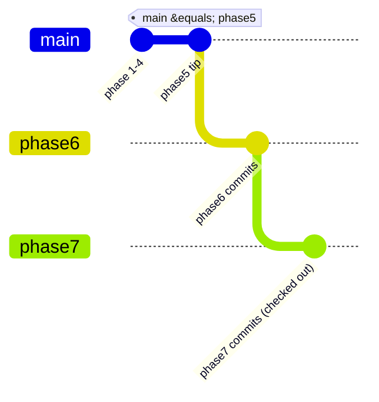

# Phase B: Git Workflow, Branching, Dependencies, Configuration, Project Structure

Read-only analysis of all ten repositories (`phase7` checked out). Nothing was changed.

---

## 1. Git: what the history shows

| Repo | Commits | First commit | Remote |
|---|---|---|---|
| infrastructure | 28 | 2026-10-13 | `cc-ecommerce-infrastructure` |
| inventory | 16 | 2026-10-13 | `cc-ecommerce-inventory-service` |
| saga | 15 | 2026-10-13 | `cc-ecommerce-saga-orchestrator` |
| frontend | 14 | 2026-10-13 | `cc-ecommerce-frontend` |
| auth, order | 13 each | 2026-10-13 | `cc-ecommerce-*` |
| contracts, notification, payment | 11 each | 2026-10-13/15 | contracts: **none**; others `cc-ecommerce-*` |
| product | 8 | 2026-10-13 | `cc-ecommerce-product-service` |

- **One author** (`rcky1100`). Every commit carries the trailer `Co-Authored-By: Claude Opus 5.5`, so this
  codebase was produced with an AI coding assistant over three days. That's worth keeping in mind as a reviewer: the code
  is consistent and well commented, but it has never run in AWS, and the docs sometimes describe intent rather than what
  was implemented (Phase A §4 doc drift). Treat docs as claims and the code as the evidence. That has been the method throughout these notes.
- **Commit messages** are imperative, specific and scoped ("Startup drain: a hard wall-clock bound", "Answer a duplicate
  RefundRequested again once the refund is final"). Each describes the behavior change, not the files touched. Good.
  There is no Conventional Commits prefix (`feat:`, `fix:`), which is fine unless you want automated changelogs.
- **Tags** exist only in contracts (`v1.0.0`–`v1.3.0`, annotated by `npm version`). The services aren't versioned:
  the deployable identity is the **git SHA** (image tag), which suits continuous deployment.

### Branch topology (same shape in every repo except contracts)



| Ref | Meaning |
|---|---|
| `main` | = `phase5` tip locally; ahead of `origin/main` by 2–11 commits (unpushed) |
| `phase5`, `phase6`, `phase7` | **stacked, long-lived phase branches**: phase7 contains phase6, which contains phase5 (`git branch --merged phase7` lists all) |
| contracts | only `main` + `phase7` (+ two `demo/*` branches, never merged) |

This is a **stacked-branch** workflow: each phase builds on the previous one, and nothing is merged until a phase
is done. It worked for building the platform alone. For ongoing work it has costs:
- `main` on GitHub lags far behind what you're running, so CI there validates old code.
- A long-lived branch accumulates risk. Merging `phase7` turns on the deploy workflows all at once (N-09).

### Recommended workflow from here (trunk-based, short-lived branches)

1. Bring `main` up to date in **small, safe steps** instead of one big merge, e.g. a branch `ci-hardening` from
   `phase7` containing only the N-09 workflow changes. Merge and push, watch CI. Then the next slice.
2. Keep `deploy.yml` inert (dispatch-only) until infrastructure exists (N-09), so merging is never "accidentally deploying".
3. Protect `main` on GitHub: PRs required, required checks (`CI / test`, `CI / docker`), no force push.
4. Delete `phase5`/`phase6` once `main` contains them (`git branch -d` refuses if unmerged, which is a useful safety check).

### Git commands: use, caution, avoid

| Command | Use | Caution / avoid | Why |
|---|---|---|---|
| `git switch -c feature/x main` | start each change from up-to-date `main` | branching from a stale phase branch | smaller diffs, fewer conflicts |
| `git rebase main` (your own, unpushed branch) | keep a feature branch current, linear history | rebasing **shared/pushed** branches | it rewrites commit ids others already have |
| `git merge --no-ff` / squash-merge via PR | integrating into `main` | — | squash = one commit per change (easy revert) |
| `git push --force-with-lease` | after rebasing your own branch | plain `--force`; any force on `main` | `--with-lease` refuses if someone else pushed |
| `git revert <sha>` | undoing something on `main` | `git reset --hard` + force push on shared branches | revert keeps history; reset rewrites it |
| `git branch -d` | delete merged branches | `-D` (force) without checking | `-d` refuses unmerged work |
| `git stash` | quick context switch | long-lived stashes (forgotten work) | — |
| `git tag -a vX.Y.Z` / `npm version` | contracts releases | moving or deleting a published tag | consumers pin tags (vendor.mjs resolves them) |
| `git log --oneline main..phase7` | see what's unmerged | — | used throughout these notes |

## 2. Dependency management

### Node services (8 repos)

| Mechanism | Where | Effect |
|---|---|---|
| Caret ranges in `package.json` (`"express": "^5.3.0"`) | all | allow minor/patch updates **when the lockfile is regenerated** |
| `package-lock.json` (committed) | all | the exact tree; `npm ci` installs exactly it (CI, Docker) |
| `engines: { node: ">=22.12" }` | all | a minimum, not a pin |
| `.nvmrc` = `24` | all | intended major for local `nvm use`, CI `setup-node`, Docker `node:24-alpine` |
| `overrides` | auth: `deepmerge-ts 8.0.2`, `mysql2 3.24.5` (Prisma CLI advisories); inventory: `@nestjs/swagger → js-yaml ^5.4.1` | force a transitive version without waiting for the parent package. Document why, and remove when upstream catches up |
| `"type": "module"` (ESM) | all except inventory | NodeNext ESM with `.js` import suffixes; **inventory is CommonJS** (Nest's default toolchain) |

**Local Node version: your machine runs Node v25.2.1** (seen when this analysis ran `node -e`), while `.nvmrc`, CI and
the images use **24**. `engines` allows 25, so nothing stops you, but native modules (argon2, Prisma engines) and
behavior can differ. Run `nvm use` (or `fnm`) in each repo before `npm ci`.

Key runtime libraries (the "why" for each is in the phase where it's used):

| Concern | Library | Where |
|---|---|---|
| HTTP | Express 5 (async errors propagate natively) / NestJS 11 / FastAPI | services |
| Validation + types | Zod 4 (`z.infer`) / class-validator (Nest) / Pydantic 2 | all |
| OpenAPI | `@asteasolutions/zod-to-openapi` / `@nestjs/swagger` / FastAPI | Phase L |
| DB | Prisma 7 + `@prisma/adapter-pg` / TypeORM / Mongoose 9 / raw `pg` / SQLAlchemy 2 | Phase A §4 |
| Messaging | `@aws-sdk/client-sns`, `client-sqs` v3 | all messaging services |
| JWT | `jose` 6 (5 in inventory) / PyJWT | Phase C |
| Passwords | `argon2` (native, prebuilt binaries) | auth |
| Logging | `pino` + `pino-http` / `nestjs-pino` / `structlog` | Phase M |
| Frontend | React 19, React Router 8, TanStack Query 5, Zustand 5, react-hook-form + Zod, Tailwind 4 (Vite plugin) | Phase H |

### Python (product)

`pyproject.toml` declares **ranges** (`fastapi>=0.143,<1`). `requirements.txt` / `requirements-dev.txt` contain **exact
pins** (`==`, 43 packages in dev) and are what CI and the Dockerfile install (`pip install -r` then `pip install --no-deps .`).
This is the "abstract vs concrete dependencies" split: the package says what it's compatible with, the lock says what you
tested. Hash pinning (`--require-hashes`) would add integrity (N-19).

### Upgrading safely (recommended practice)

1. One dependency (or one family) per PR. `npm install pkg@^x.y` regenerates the lockfile; review the lockfile diff size.
2. Run CI (audit, typecheck, tests, image build). For Prisma/TypeORM/Alembic upgrades, also check the migration drift steps.
3. For security fixes in transitive deps: upgrade the parent first; use `overrides` only with a comment and a removal plan.
4. Automate the proposals with Dependabot/Renovate (N-19); humans review and merge.

## 3. Configuration: one pattern, four stacks

Every service reads **environment variables only**, validates them **once at startup**, and **refuses to boot** if they're
invalid. Example: [auth env.ts](ecommerce-auth-service/src/config/env.ts):

| Technique | Lines | Purpose |
|---|---|---|
| `z.coerce.number().int().min(…)` | 38, 57 | env vars are strings; coerce + range-check |
| `bool = z.enum(["true","false"]).transform(…)` | 3 | avoids the `Boolean("false") === true` trap |
| JSON-in-env parsed and validated (`SERVICE_CLIENTS`, `JWT_SIGNING_KEYS`) | 11–30, 64–76 | structured secrets from Secrets Manager, with readable errors **that never echo the value** |
| `.refine(…)` production guards | 108–115 | `NOTIFICATION_DELIVERY=smtp-dev` and `COOKIE_SECURE=false` are **rejected** with `NODE_ENV=production` (Payment does the same for `PAYMENT_PROVIDER=mock`) |
| Safe local defaults | throughout | `npm run dev` works with an almost empty `.env`; production must set real values |
| `loadEnv()` → `z.prettifyError` | 119–125 | one clear message listing every bad variable |

Equivalents: Nest/inventory uses Zod too ([inventory env.ts](ecommerce-inventory-service/src/config/env.ts)); Product
uses **pydantic-settings** ([config.py](ecommerce-product-service/app/config.py)) with `Field(pattern=…)`, `Literal[...]`
enums and a `field_validator` for comma lists, cached by `@lru_cache`.

Configuration layers, from lowest to highest precedence:

| Layer | Local | CI | AWS (designed) |
|---|---|---|---|
| Code defaults | `env.ts` defaults | same | same |
| `.env` file (git-ignored; `.env.example` committed and documented) | `npm run dev` via `tsx --env-file-if-exists` | — | — |
| compose `environment:` | full stack | — | — |
| workflow `env:` | — | DB URLs, Floci endpoint | — |
| Task definition env + Secrets Manager `secrets` | — | — | `stack/main.tf` map + per-service secret (Phase K-3) |

Small inconsistencies found:
- The auth comment on `TRUST_PROXY_HOPS` says "1 behind an ALB". The real design (CloudFront → ALB) uses **2**, as
  `stack/main.tf` sets correctly. The comment is stale.
- `COOKIE_DOMAIN`'s comment mentions a "storefront subdomain". The one-origin design doesn't need it.
- Product's `Settings` reads `.env` (`env_file=".env"`); the Node services read `.env` only via the `dev` script. This is harmless (no
  `.env` exists in images), but different.

Never commit `.env`. Every repo's `.gitignore` has `.env`, `.env.*`, `!.env.example`, and gitleaks configs exist (not
run in CI: N-19).

## 4. Project structure conventions (why each folder exists)

### Express + TypeScript services (auth, order, payment, saga, notification)

```
src/
  server.ts        composition root: load env, build dependencies, start HTTP + workers, graceful shutdown
  app.ts           createApp(deps): middleware order, routers, error handler (no I/O at import, so tests build it freely)
  config/env.ts    the validated config (§3)
  db/              pool / prisma / mongo connection + transaction helper
  lib/             logger, problem (RFC 9457 errors), zod setup, envelope helpers, ids
  middleware/      request-context (correlation), authenticate/requireRole, validate, error-handler, (auth: csrf, rate-limit)
  routes/health.ts liveness/readiness
  <domain>/        the business logic: orders/, payments/, saga/, notifications/, modules/auth (auth groups by module)
  api/ or routes   HTTP adapters: parse → call service → map to DTO
  messaging/       outbox-relay, command/inbox consumer, parsers, runner (start/stop of loops)
  clients/         outbound HTTP (service tokens, timeouts, result classification)
  security/        token verification, (auth: key store, password, token service)
  openapi/         document.ts (generated spec) + scripts/export-openapi.ts
  scripts/         one-off CLIs (create-admin, generate-key, sync-indexes)
tests/             Vitest: global-setup (fresh DB + real migrations), helpers, *.test.ts
migrations/        SQL files (node-pg-migrate) | prisma/ (auth) | events/ (vendored contracts) | openapi/ (committed spec)
```

The key design rule: **`server.ts` is the only file that does real wiring**. `createApp(deps)`, `SagaEngine`, the relays and
the consumers all take their dependencies as constructor arguments. That's why tests can swap in fake clocks, stub
gateways and test DBs without mocking libraries. This is plain dependency injection, with no framework.

### NestJS (inventory)
`*.module.ts` (DI containers), `*.controller.ts` (HTTP), `*.service.ts` (logic), `entities/` (TypeORM),
`dto.ts` (class-validator), `common/` (filters, pipes, middleware), `database/migrations/`. The same responsibilities as above,
expressed with decorators and Nest's injector.

### FastAPI (product)
`app/main.py` (create_app), `routers/` (HTTP), `catalog.py` (logic), `models.py` (SQLAlchemy), `schemas.py` (Pydantic
DTOs), `deps.py` (FastAPI dependencies: DB session), `security.py`, `errors.py` (problem+json), `alembic/versions/`.

### Frontend
`src/api/` (typed clients + generated contract types), `auth/`, `cart/`, `checkout/` (state and logic), `pages/` (routes),
`components/`, `config/env.ts` (validated `VITE_*`), `test/`, plus `e2e/` (Playwright).

### Common files in every repo

| File | Purpose |
|---|---|
| `.editorconfig` | UTF-8, LF, 2-space indent, final newline, trim whitespace (not in `.md`) |
| `.nvmrc` / `.python-version` | runtime version for nvm/pyenv and the CI setup actions |
| `.gitignore` | `node_modules/`, `dist/`, `coverage/`, `.env*`, `*.log`; auth also `src/generated/` (Prisma client) and `keys/` (local JWT keys) |
| `.dockerignore` | keeps `node_modules`, `.git`, `.env` and tests out of build contexts |
| `.gitleaks.toml` | default rules + narrow allowlists (lock hashes, PEM placeholder, password denylist) |
| `eslint.config.js` | flat config with typescript-eslint |
| `tsconfig.json` / `tsconfig.build.json` | type-check everything (incl. tests, `noEmit`) vs compile `src` only |
| `compose.yaml` | that service's own DB, for standalone development |
| `README.md`, `docs/api.md`, `docs/events.md` | per-service docs |

### TypeScript compiler options worth knowing ([auth tsconfig.json](ecommerce-auth-service/tsconfig.json))
`strict`, **`noUncheckedIndexedAccess`** (`arr[0]` is `T | undefined`: catches a whole class of runtime crashes, and is why
the code has `rows[0]!` where a row is guaranteed), `verbatimModuleSyntax` (explicit `import type`), `module/moduleResolution:
NodeNext` (real ESM semantics).

## 5. Phase B summary, exercises, acceptance criteria

**Findings (added to the backlog as notes, no new P1):** the stacked long-lived branch strategy (keep the merge plan
incremental: N-09); local Node 25 vs the project's 24; stale config comments (`TRUST_PROXY_HOPS`, `COOKIE_DOMAIN`) → N-25.

**Exercises:**
1. Run (read-only) `git log --oneline --graph --all -20` in one repo and identify `main`, `phase5–7` and `origin/main`.
2. Plan the first small PR to bring `main` forward: which commits from `phase7` are safe to land while deploy stays inert?
3. In `auth env.ts`, find three variables that would make the service refuse to boot in production, and explain why each is dangerous.
4. Explain why `"express": "^5.3.0"` in `package.json` doesn't mean CI might install 5.9 tomorrow.

**Acceptance criteria:** you can explain the branch topology and a safe merge plan; the lockfile vs range distinction
for npm and pip; the fail-fast config pattern and its production guards; and what each top-level folder of a service
is for, especially why `server.ts` is the only wiring point.
