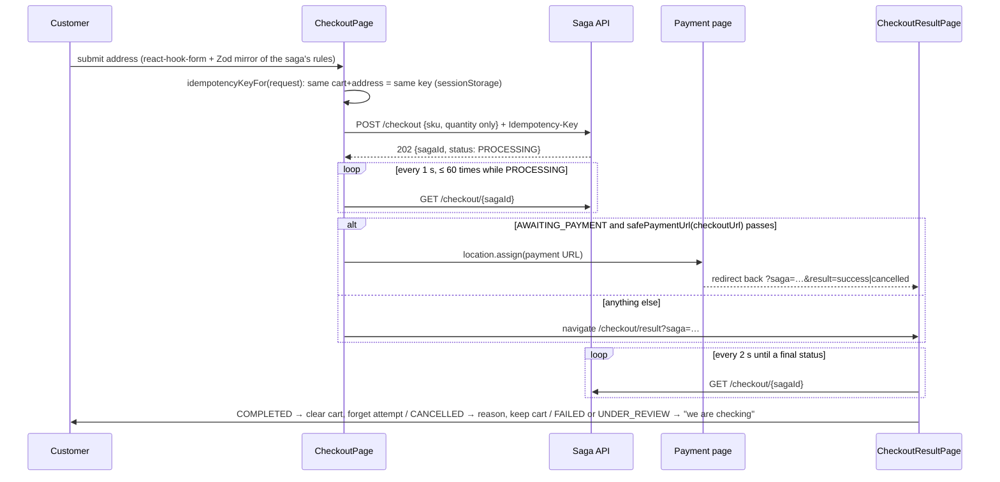

# Phase H: React Frontend and Backend Integration

Read-only walkthrough of `ecommerce-frontend` (React 19, Vite 8, React Router 8, TanStack Query 5, Zustand 5,
react-hook-form + Zod, Tailwind 4) on `phase7`.

---

## 1. Responsibility and the trust rule
The frontend renders the shop and admin UI. **It is never trusted.** Everything it shows (prices, stock, totals, roles) is a copy.
Everything it sends is re-validated server-side, and authorization is enforced by the APIs: "The APIs enforce this regardless; this is
only UX" ([guards.tsx](ecommerce-frontend/src/auth/guards.tsx)). Keep this rule in mind when reviewing any frontend code:
a bug here should cost **UX, never money or data**.

## 2. Boot and structure
- [main.tsx](ecommerce-frontend/src/main.tsx): one `QueryClient` (`staleTime` 30 s; **retry only network errors and 5xx**, never
  4xx), `createBrowserRouter(routes)`, `bootstrapSession()` (resume a session from the refresh cookie), `StrictMode`.
- [routes.tsx](ecommerce-frontend/src/routes.tsx): public pages (home, catalog, product, cart, auth pages), `RequireAuth`
  pages (checkout, result, account, orders, notifications), and a `RequireAdmin` subtree loaded **lazily** (`pages/admin/lazy.tsx`),
  so the admin code isn't in the customer bundle.
- [config/env.ts](ecommerce-frontend/src/config/env.ts): `VITE_*` URLs validated with Zod. They're **inlined at build time and
  public** ("never put secrets in VITE_* variables").
- [vite.config.ts](ecommerce-frontend/vite.config.ts): a separate `vendor` chunk (libraries change less often than app code, so it stays
  cached across releases); Vitest with jsdom.

| Folder | Purpose |
|---|---|
| `src/api/` | `http.ts` (fetch wrapper), per-service clients (`catalog`, `orders`, `admin`, `notifications`, `auth`), `generated/` (types from pinned OpenAPI), `contract-check.ts` |
| `src/auth/` | `session.ts` (Zustand store, refresh logic), `guards.tsx`, `redirect.ts` (safe `next=` handling) |
| `src/cart/`, `src/checkout/` | cart store; checkout idempotency + payment-URL allowlist + failure messages |
| `src/pages/`, `src/components/` | routes and UI primitives |
| `src/lib/` | `money.ts` (formatting/parsing without floats), `errors.ts`, `browser.ts` (a seam for `location.assign`, so tests can intercept it) |

## 3. The HTTP layer ([api/http.ts](ecommerce-frontend/src/api/http.ts))
- JSON in/out; **problem+json → `ApiError`** with `status`, `code`, `detail`, field errors and **correlation id** (from the body or
  the `X-Correlation-Id` header), so support can find the server logs.
- Bearer token from the session store; `credentials: "omit"` by default, and **`include` only for Auth's refresh/logout**
  (a test asserts cookies are never sent to other APIs).
- One transparent retry after a 401: refresh, then resend once. Concurrent 401s share **one** refresh (tested).
- `newIdempotencyKey()` = `crypto.randomUUID()`, one per user action.

## 4. Session management ([auth/session.ts](ecommerce-frontend/src/auth/session.ts))
Explained in Phase A-5 / C-1.6. In short:
- The access token lives **in memory only**.
- It's refreshed 60 s before expiry.
- Refresh is single-flight within the tab and **serialized across tabs** with the Web Locks API (rotation + reuse detection would
  otherwise log users out).
- Only 401/403 sign the user out; a 5xx is retried; a network error is **not** retried (the server may already have rotated).

## 5. Cart ([cart/cart.ts](ecommerce-frontend/src/cart/cart.ts))
- Zustand + `persist` to **localStorage** (`cart.v1`). The fields that matter are `{sku, quantity}`. Name, image and unit price are
  **display copies**: "a stale copy can never change what is charged".
- Quantities clamped 1–10, ≤ 50 lines, and the **merge validator drops malformed stored lines** (old versions, manual edits). Never
  trust what you read back from storage.
- `cartSubtotal` is a display-only estimate. Tax, discount and shipping come from Order.

## 6. Checkout flow in the browser ([CheckoutPage.tsx](ecommerce-frontend/src/pages/CheckoutPage.tsx), [CheckoutResultPage.tsx](ecommerce-frontend/src/pages/CheckoutResultPage.tsx), [checkout.ts](ecommerce-frontend/src/checkout/checkout.ts))

Correctness points, each tested ([checkout.test.tsx](ecommerce-frontend/src/test/checkout.test.tsx)):
- **Only SKUs and quantities are sent.** No prices.
- **One idempotency key per attempt**: a double click, a retry or a reload re-sends the same key and gets the same saga.
  Changing the cart or address is a new attempt.
- **`safePaymentUrl`** redirects only to the Payment API's origin (mock) or `https://checkout.stripe.com`; `javascript:` URLs and
  other origins are refused. This defends against a compromised or misconfigured backend sending the customer somewhere else.
- **`?result=success` proves nothing**: the result page waits for the saga's `COMPLETED` (which follows the verified webhook).
- 429 `TOO_MANY_ACTIVE_CHECKOUTS` has its own explanation; `describeFailure(code)` maps saga failure reasons to human text.
- Mixed-currency carts are blocked before submit.

## 7. Contract safety (Phase L-2 §3)
`src/api/generated/*.ts` are produced from the **pinned** OpenAPI documents (`contracts/openapi`, v1.3.0) by `openapi-typescript`.
[contract-check.ts](ecommerce-frontend/src/api/contract-check.ts) asserts 16 times that `Published` types are assignable to what the UI
reads, so an API that drops a field fails `npm run typecheck`. CI regenerates the types and fails on any diff.

## 8. Money in the UI ([lib/money.ts](ecommerce-frontend/src/lib/money.ts))
`formatMoney` formats integer minor units with `Intl.NumberFormat` **without dividing floats**: it splits major/minor with integer
math and substitutes the fraction part. `parseMajor("1,177.64", "INR") → 117764` uses **string arithmetic** and rejects too many
decimals and unsafe integers. Admin price inputs are in rupees and are sent as paise (tested). `currencyDigits` handles JPY (0) vs INR (2).

## 9. Security headers and storage
- Production: CloudFront response-headers policy (strict CSP `default-src 'self'`, `connect-src 'self'`, HSTS, DENY framing).
  Local and compose: [nginx.conf](ecommerce-frontend/nginx.conf) applies the same policy.
- **No tokens in web storage** (E2E and unit tests assert there's no `eyJ` in localStorage/sessionStorage). sessionStorage holds only the
  checkout attempt key; localStorage only the cart.
- Open-redirect protection for `?next=` after login: same-site paths only (tested in `core.test.ts`).

## 10. Observations (small)
- The admin alert for `CANCELLATION_PENDING` is stale and misleading (**N-33**, Phase E §5).
- Country is limited to `IN` in the checkout form (a product scope decision; Order validates currencies separately).
- The checkout page gives up its own polling after 60 s of `PROCESSING` and hands over to the result page, which keeps polling every 2 s.
  That's a good split, so the user is never stuck on a disabled form.
- No client-side error reporting (Sentry etc.). JS errors in customers' browsers are invisible (P3; it fits N-21).

## 11. Tests
Unit/component (Vitest + Testing Library, `src/test/`): `core` (money, http client, refresh behavior, cart, redirects),
`checkout`, `admin` (money input, access, refunds, If-Match, stock adjustments), `pages`, `routes`, `env`, `contracts`.
E2E (Playwright, `e2e/smoke.spec.ts`): the full purchase and fulfillment journey against the running platform (Phase M-0 §2).

## Exercises and acceptance criteria (Phase H)
1. Explain why the cart may keep a stale price and why that's safe.
2. Trace a double click on "Place order": which keys, how many sagas, what the user sees.
3. A backend returns `checkoutUrl: "https://evil.example/pay"`. Which line stops the redirect, and what does the user see?
4. Why can two open tabs refresh the session without logging the user out?

**You're done with Phase H when** you can trace checkout from form submit to the confirmation page, name every place the UI
deliberately refuses to trust data, and explain how the type-level contract check protects the UI.
