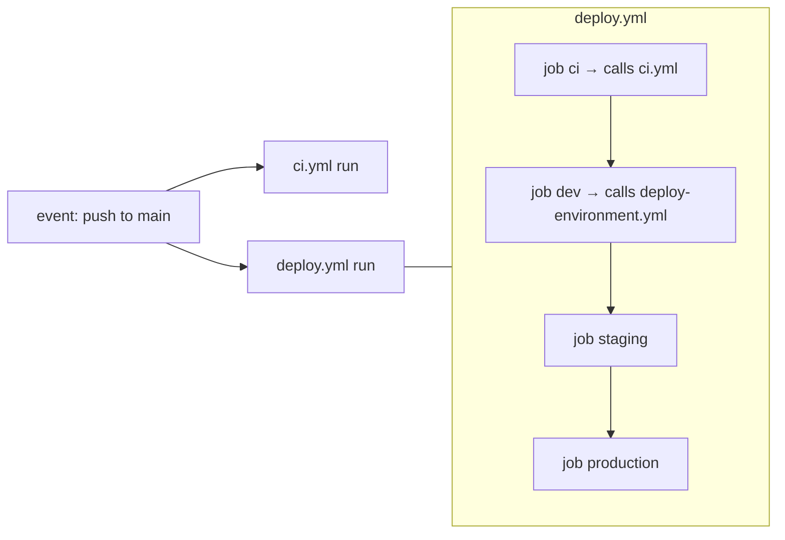

# Phase J: CI/CD and GitHub Actions (Overview and Fundamentals)

Scope: every file under `.github/workflows/` in all ten repositories, on the `phase7` branch. This is a
**read-only** explanation. No workflow, test or deploy was run, and no GitHub run history was available. Your
decision to keep `phase7` unmerged is the right call: merging it would activate the deploy workflows (see J-3).

## Files in this phase

| File | Covers |
|---|---|
| **PHASE-J-0-overview.md** (this) | GitHub Actions mental model, every keyword used, how the 21 workflows fit together |
| [PHASE-J-1-node-service-ci.md](PHASE-J-1-node-service-ci.md) | `ci.yml` of the six Node backends, line by line, every command |
| [PHASE-J-2-other-ci.md](PHASE-J-2-other-ci.md) | Product (Python), Frontend, Contracts, Infrastructure `ci.yml` and the nightly `e2e.yml` |
| [PHASE-J-3-deploy-pipeline.md](PHASE-J-3-deploy-pipeline.md) | `deploy.yml` + `deploy-environment.yml` (ECS and the S3 frontend variant), the generator script |
| [PHASE-J-4-commands-do-and-dont.md](PHASE-J-4-commands-do-and-dont.md) | Recommended vs cautioned commands and practices (table D) |
| [PHASE-J-5-security-model.md](PHASE-J-5-security-model.md) | Permissions, triggers, OIDC, environments, pinning, provenance, state, rollback |
| [PHASE-J-6-troubleshooting.md](PHASE-J-6-troubleshooting.md) | Per-stage failure guide (hypothetical errors, clearly labeled) |
| [PHASE-J-7-independent-pipelines.md](PHASE-J-7-independent-pipelines.md) | Cross-repo comparison, contracts flow, a proposed CI/CD standard, findings, exercises, acceptance criteria |

---

## 1. The GitHub Actions mental model in five sentences

1. A **workflow** is a YAML file in `.github/workflows/`. An **event** (`on:`), such as a push, a PR, a schedule or a
   manual click, starts a **run** of it.
2. A run contains **jobs**. Each job gets a **fresh virtual machine** (`runs-on: ubuntu-latest`), so nothing on disk
   carries over between jobs unless you upload an artifact or use a cache.
3. Jobs run **in parallel** unless `needs:` orders them. A job is skipped if a job it needs failed.
4. A job is a list of **steps**. A step either runs a shell command (`run:`) or calls a packaged **action**
   (`uses: owner/repo@ref`). Steps share the job's filesystem and environment.
5. A workflow can call another workflow (**reusable workflow**, `on: workflow_call`) as if it were a job. This
   project uses that to make `deploy.yml` run the repo's own `ci.yml` first.

## 2. How the 21 workflow files relate

| Repo group | Files | Relationship |
|---|---|---|
| 8 deployable repos (7 backends + frontend) | `ci.yml`, `deploy.yml`, `deploy-environment.yml` | `deploy.yml` calls `ci.yml` (job `ci`), then calls `deploy-environment.yml` three times with `environment: dev / staging / production` |
| `ecommerce-contracts` | `ci.yml` | standalone; also runs on tags `v*` |
| `ecommerce-infrastructure` | `ci.yml`, `e2e.yml` | standalone; `e2e.yml` clones all ten repos nightly |

The deploy files are **generated** by `ecommerce-infrastructure/scripts/generate-workflows.py` from
`ecommerce-infrastructure/templates/` (`deploy.yml`, `deploy-job.yml`, `deploy-frontend-job.yml`). The generator
also inserts `workflow_call:` into each repo's `ci.yml` so it can be called. **Never edit a generated file in the
service repo**; the header says so, and the next generation would overwrite you.

## 3. Every workflow keyword that appears, explained

| Keyword (as used) | Meaning | Where | Notes / pitfalls |
|---|---|---|---|
| `name: CI` | Display name in the Actions tab; also `github.workflow` | all | In a **called** workflow, `github.workflow` is the **caller's** name |
| `on: push: branches: [main]` | Run when commits land on `main` | all CI, deploy | Merge commits from PRs count as pushes |
| `on: pull_request` | Run for PRs targeting any branch, on the **merge commit** of PR + base | all CI | Fork PRs get a **read-only** token and **no secrets**. That makes it safe to run untrusted code |
| `on: push: tags: ["v*"]` | Run when a tag such as `v1.3.0` is pushed | contracts | Release verification |
| `on: workflow_call` (+ `inputs`) | Makes the workflow callable from another workflow | all `ci.yml`, `deploy-environment.yml` | Called workflows share the caller's `github` context (ref, sha, event) |
| `on: workflow_dispatch` | Manual "Run workflow" button (any branch the user picks) | `deploy.yml`, `e2e.yml` | **Anyone with write access can run it on any branch**; see J-5 for why GitHub Environment branch rules matter |
| `on: schedule: - cron: "30 21 * * *"` | Time trigger in **UTC** (21:30 UTC = 03:00 IST) | `e2e.yml` | Runs on the default branch only; can be delayed under load; disabled after 60 days without repo activity |
| `permissions: contents: read` | Scopes the auto-generated `GITHUB_TOKEN` | CI files, deploy-environment | Everything not listed becomes `none` |
| `permissions: id-token: write` | Lets the job request an **OIDC JWT** from GitHub | deploy | Required for `configure-aws-credentials` with `role-to-assume` and no keys |
| `concurrency: group / cancel-in-progress` | At most one running (and one pending) run per group | CI (`ci-${{ github.ref }}`, cancel), deploy (no cancel) | Pending runs beyond one are **replaced** by newer ones |
| `jobs.<id>.runs-on: ubuntu-latest` | GitHub-hosted Linux VM | all | `latest` moves (e.g. 24.04 → next), so tools preinstalled on the image change over time |
| `needs: test` | Job ordering + skip on failure | `docker` job, deploy chain | |
| `services:` | Sidecar containers for the job (Postgres, Mongo, Floci) | Node CI, Product CI | With `ports: ["5432:5432"]` they are reachable on `localhost` from steps that run directly on the VM |
| `options: --health-cmd …` | Docker health check; the job **waits** until the service is healthy before steps start | services | Without it, tests race the DB startup |
| `env:` (job level) | Environment variables for every step | CI (DB URLs) | Visible in logs if echoed; only for non-secret values |
| `steps[].uses: actions/checkout@v4` | Calls an action at a **git tag** | all | Tags are mutable; see pinning in J-5 |
| `steps[].with:` | Inputs to an action | setup-node, setup-python, … | |
| `steps[].run:` (single line or `\|` block) | Shell command; `bash -e` on Linux by default | all | Multi-line blocks stop at the first failing line, but pipes hide failures unless `set -o pipefail` (deploy uses `set -euo pipefail`) |
| `steps[].name:` | Label in the UI | many | Steps without a name show their command |
| `steps[].id:` + `steps.<id>.outputs.*` | Read an earlier step's outputs | `id: ecr` → `steps.ecr.outputs.registry` | |
| `steps[].if:` | Conditional step | deploy (`if: true`), e2e (`if: failure()`) | `failure()` = an earlier step failed in this job |
| `steps[].working-directory:` | `cd` for that step | infra, e2e | |
| `strategy.matrix` | Fan one job out into N parallel jobs | infra (5 roots, 8 modules) | One failing entry doesn't cancel the others unless `fail-fast` (default **true**) |
| `timeout-minutes: 60` | Hard job timeout | e2e | Default is 360 minutes, so set it everywhere for cost control |
| `jobs.<id>.environment: ${{ inputs.environment }}` | Binds the job to a **GitHub Environment** (its variables, secrets, protection rules) | deploy | The OIDC `sub` claim then contains `environment:<name>`, which is what the AWS trust policy checks |
| `${{ vars.X }}` | Configuration **variables** (repo/org/environment level), not secret | deploy | Printed in logs. Correct for role ARNs and region, not for secrets |
| `${{ secrets.X }}` | Encrypted secrets | **none used anywhere** | A good sign: OIDC replaced keys |
| `$GITHUB_ENV` | Append `NAME=value` to export to later steps | deploy (`IMAGE=…`) | |
| `uses: ./.github/workflows/ci.yml` | Call a reusable workflow from the same repo at the same commit | `deploy.yml` | |
| `uses: docker://rhysd/actionlint:1.7.7` | Run a container image as a step | infra | Tag-pinned image |

## 4. Trigger matrix: what runs when (once `phase7` were merged)

| Event | Node backend / frontend | Product | Contracts | Infrastructure |
|---|---|---|---|---|
| PR opened/updated | `ci.yml` | `ci.yml` | `ci.yml` | `ci.yml` |
| Push to `main` | `ci.yml` **and** `deploy.yml` (which calls `ci.yml` again) | same | `ci.yml` | `ci.yml` |
| Push tag `v*` | — | — | `ci.yml` | — |
| Manual | `deploy.yml` (any branch) | `deploy.yml` | — | `e2e.yml` |
| 21:30 UTC daily | — | — | — | `e2e.yml` |

**Today on GitHub** (`origin/main`) only `ci.yml` exists, so only the first column's CI part is live.
Note that CI runs **twice** per push to `main`, and the two copies share a concurrency group (finding J-F2 in J-7).

## 5. What a green pipeline proves, and what it does not

Green CI here proves: dependencies install from the lockfile; there are no **known** high/critical advisories **today**;
lint and types are clean; migrations apply to an empty DB (and some round-trip); models match migrations; tests pass
against real Postgres/Mongo and an SNS/SQS **emulator**; the images **build**.

It does **not** prove: that the code is secure (only that it passes the checks configured); real AWS behavior
(IAM, KMS, FIFO limits, throttling); that migrations are safe on **production-sized** data or with the **previous**
release still running; cross-service compatibility beyond pinned schemas; performance; or that the deploy
works (never run). See PHASE-A-3 §5 for how CI differs from production (Floci instead of AWS, throwaway DBs,
mock payment provider). Every difference there is something CI cannot catch.
