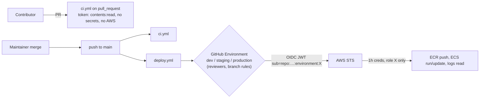

# Phase J-5: The CI/CD Security Model

The question this file answers: **who can make code run with which privileges, and how could that be abused?**

## 1. Workflow permissions and least privilege

| Workflow | Token permissions | Assessment |
|---|---|---|
| all `ci.yml` | `contents: read` | ✓ minimal |
| `deploy-environment.yml` | `contents: read`, `id-token: write` | ✓ only what OIDC needs |
| `deploy.yml` | per-job on the three deploy jobs; **no top-level block** | Add top-level `permissions: contents: read` so any future job defaults to read-only |
| infra `ci.yml`, `e2e.yml`, contracts `ci.yml` | `contents: read` | ✓ |

**AWS-side least privilege** ([github-oidc/main.tf:111-188](ecommerce-infrastructure/terraform/modules/github-oidc/main.tf#L111-L188)):
the deploy role can push to **its own** ECR repo, register/describe task definitions, update/describe **its** service,
`RunTask` only for **its own migrate task family** and only in its cluster (`ecs:cluster` condition), `iam:PassRole` only for **its** task + execution roles
(and only to ECS), and read its log group. The frontend role gets `s3:Put/Get/Delete` on its bucket and
CloudFront invalidations. One caveat: `ecs:RegisterTaskDefinition` can't be scoped to a family in IAM. A
compromised deploy job could therefore register any task definition, but `PassRole` limits which roles it can attach, so it
can't escalate to another service's permissions. That is a sound design.

## 2. `pull_request` vs `push` vs privileged triggers

| Trigger | Code that runs | Secrets / write token | Use here |
|---|---|---|---|
| `pull_request` (from a fork) | **untrusted** PR code | **No** secrets, read-only token | CI only ✓ |
| `pull_request` (same-repo branch) | PR code by someone with write access | secrets available | CI holds none, so this is moot ✓ |
| `pull_request_target` | base-branch workflow, privileged | **yes** | not used ✓ |
| `push: main` | reviewed, merged code | environment vars/secrets | deploy ✓ |
| `workflow_dispatch` | **any branch** the user selects | same as push | ⚠ see §4 |
| `schedule` | default branch | yes | e2e ✓ |

**Risk of running untrusted code with secrets:** a malicious PR can change test files or `package.json` scripts
to print `env`, or to send the token or an OIDC JWT to an attacker. With `pull_request` from forks there is nothing to
steal. Keep it that way: never add `secrets:` to `ci.yml`, never switch CI to `pull_request_target`.

## 3. OIDC to AWS: what makes it safe

The trust policy requires **all** of:
1. issuer = GitHub's OIDC provider,
2. `aud` = `sts.amazonaws.com`,
3. `sub` = **exactly** `repo:<owner>/<repo>:environment:<env>` (`StringEquals`, no wildcards).

So a token from another repo, from a fork, or from a job **without** `environment: production` can't assume the
production role. The trust is anchored to the **GitHub Environment**, which makes Environment protection rules the real
security boundary (§4).

Gaps to fix before use: `<repo>` is hard-coded as `ecommerce-${name}`
([stack/main.tf:313](ecommerce-infrastructure/terraform/modules/stack/main.tf#L313)). Your repos are `cc-ecommerce-*`, so add
a `repo_prefix` variable (default `"cc-ecommerce-"`) rather than renaming repos.

## 4. GitHub Environments and approval gates (configure on GitHub, not in YAML)

| Setting | dev | staging | production | Why |
|---|---|---|---|---|
| Deployment branches/tags | `main` only | `main` only | `main` only | Otherwise `workflow_dispatch` on a feature branch, or a workflow added in a branch that names `environment: production`, satisfies the OIDC `sub` and deploys unreviewed code |
| Required reviewers | — | optional | **yes** (not yourself, if a team exists; "prevent self-review") | Human gate on production |
| Wait timer | — | — | optional (e.g. 5 min) | Time to cancel |
| Variables | `AWS_DEPLOY_ROLE_ARN`, `AWS_REGION`, `ENV_PREFIX`, `CLUSTER_NAME`, `PRIVATE_SUBNETS`, `TASKS_SECURITY_GROUP` (frontend: `SHOP_ORIGIN`, `SITE_BUCKET`, `DISTRIBUTION_ID`) | | | not secrets: ARNs and IDs |

Also protect the `main` branch itself: require PRs, required status checks (`CI / test`, `CI / docker`), no force
pushes. Without branch protection, "only `main` can deploy" means little.

## 5. Secret storage and rotation

| Secret | Where it lives (design) | In CI? | Rotation |
|---|---|---|---|
| AWS credentials | none: OIDC | — | not applicable |
| DB passwords | RDS-managed master secret; per-service secrets in Secrets Manager | no | RDS rotates the master secret; service secrets per runbooks.md |
| JWT signing keys | Secrets Manager `JWT_SIGNING_KEYS` (JWKS supports several `kid`s, so rotation can overlap) | no | runbook |
| Stripe keys, SMTP, service client secrets | Secrets Manager | no | runbook |
| Local values | compose / CI YAML (`*_local_pw`) | yes (throwaway) | n/a: never reuse |

Workflows reference **zero** `secrets.*`. Secret scanning: `.gitleaks.toml` exists in every repo but **no workflow
runs gitleaks**. Enable GitHub secret scanning + push protection (free on public repos) and/or add a gitleaks step.

## 6. Dependency and container vulnerability scanning

| Layer | Present | Missing |
|---|---|---|
| Node prod deps | `npm audit --omit=dev --audit-level=high` (all Node CI) | automated update PRs (Dependabot/Renovate, finding S-8) |
| Python deps | `pip-audit` on pinned runtime deps | hash pinning |
| Container OS packages | ECR `scan_on_push = true` (designed) | a CI scan before push (Trivy/Grype) that **fails** the build; scan findings don't alarm (S-9) |
| GitHub Actions | — | SHA pinning + Dependabot for `github-actions` |
| Base images | tags `node:24-alpine`, `python:3.14-slim`, `nginx-unprivileged:1.29-alpine` | digest pinning (S-8) |

## 7. Action pinning

Every `uses:` is a tag: `actions/checkout@v4`, `actions/setup-node@v4`, `actions/setup-python@v5`,
`docker/setup-buildx-action@v3`, `docker/setup-qemu-action@v3`, `docker/build-push-action@v6`,
`hashicorp/setup-terraform@v3`, `aws-actions/configure-aws-credentials@v4`, `aws-actions/amazon-ecr-login@v2`,
`docker://rhysd/actionlint:1.7.7`. A tag is a mutable pointer. If an action's repository is compromised, the attacker
can move `v4` to malicious code, and in the deploy jobs that code would run **with AWS credentials**. Pin to commit SHAs
(keep the version as a comment) and let Dependabot propose updates. Prioritize the deploy workflow's actions.

## 8. Artifact integrity and provenance

| Property | Status |
|---|---|
| Image traceable to commit | ✓ tag = `github.sha` |
| Tag can't be overwritten | ✓ ECR `IMMUTABLE` |
| Same artifact promoted dev → staging → prod | ✗ rebuilt per environment (P1-5) |
| Deploy by digest | ✗ deploys `repo:sha` (fine with immutable tags, but a digest is stronger and works across registries) |
| Signed provenance / SBOM | ✗ none. `docker buildx build --provenance=true --sbom=true`, or `actions/attest-build-provenance`, and verify before deploy |
| Contracts integrity | ✓ SHA-256 per vendored file in `contracts.lock.json`, verified by a test |

## 9. Terraform state security

- Remote state: S3 backend, `encrypt = true`, `use_lockfile = true` (S3-native locking), one key per environment
  ([backend.hcl.example](ecommerce-infrastructure/terraform/environments/dev/backend.hcl.example)). Bucket: versioned,
  public access blocked (deployment.md). Use a separate bucket or account per environment, so dev credentials can't read prod state.
- State is sensitive even without secrets (resource IDs, endpoints, sometimes generated values). This project keeps
  passwords out of state: `manage_master_user_password = true`, and Secrets Manager values are set out of band.
- CI never touches state (`-backend=false`). The local Floci state (`environments/local/terraform.tfstate`) is
  git-ignored. Good.
- Future CD for Terraform: plan with a **read-only** role on PRs (post the plan), apply with a separate role only from
  `main` + the `production` Environment.

## 10. Rollback and recovery

| Situation | Mechanism | Caveat found |
|---|---|---|
| New tasks unhealthy | ECS circuit breaker auto-rollback; the job goes red | — |
| Healthy but wrong | `aws ecs update-service --task-definition <previous revision>` (runbooks.md) | ✓ works: old revisions point at immutable images |
| "Re-run the deploy workflow for the previous commit" (runbooks.md) | — | ✗ **fails at push** (tag exists, ECR immutable): J-F1 |
| Bad migration | forward fix; expand-only rule | needs discipline in review: no destructive migration in the same release as code that stops using a column |
| Frontend | re-run deploy for the previous commit; versioned bucket | ✓ works (S3 overwrites are allowed) |

## 11. Preventing accidental production deployments: checklist

- [ ] `phase7` stays unmerged until the AWS side exists (your current choice) ✓
- [ ] Environment branch rules = `main` only, production required reviewers
- [ ] `main` branch protection with required checks
- [ ] Until AWS is ready: change `deploy.yml` to `workflow_dispatch` only, or guard the jobs with `if: vars.AWS_DEPLOY_ROLE_ARN != ''`
- [ ] Separate AWS accounts for dev/staging/prod, so a misconfigured dev role can never touch prod
- [ ] Pin deploy actions by SHA
