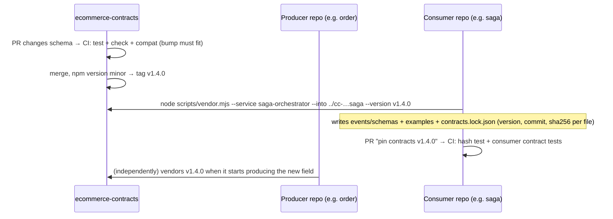

# Phase J-7: Independent Pipelines, Contracts, a Proposed Standard, Findings, Exercises

---

## 1. Side-by-side comparison of all ten pipelines

| Stage | auth | inventory | order | payment | saga | notification | product | frontend | contracts | infra |
|---|---|---|---|---|---|---|---|---|---|---|
| Locked install | npm ci | npm ci | npm ci | npm ci | npm ci | npm ci | pip -r (==) | npm ci | npm ci | — |
| Dependency audit | ✓ | ✓ | ✓ | ✓ | ✓ | ✓ | pip-audit | ✓ | ✓ | — |
| Lint / format | eslint | eslint | eslint | eslint | eslint | eslint | ruff + format | eslint | eslint | fmt, actionlint |
| Type check | tsc | tsc | tsc | tsc | tsc | tsc | — | tsc ×2 | — | validate |
| Migration apply | deploy | run/revert/run | — (Mongo) | up/down/up | up/down/up | up/down/up | up/base/up | — | — | — |
| Model ↔ migration drift | prisma diff | typeorm --check | — | — | — | — | alembic check | — | — | — |
| Tests w/ real DB | Postgres | Postgres | Mongo | Postgres | Postgres | Postgres | Postgres | — (mocked fetch) | — | mocked AWS plan |
| Messaging emulator | Floci | Floci | Floci | Floci | Floci | Floci | — | — | — | — |
| Contract checks | vendored hash test | same | same | same | same + receiver-schema test | same + producer examples | OpenAPI snapshot test | types diff + compile-time check | compat + ownership | — |
| Image build | runtime+migrate | ✓ | ✓ | ✓ | ✓ | ✓ | ✓ | nginx (gha cache) | — | — |
| Deploy | ECS | ECS | ECS | ECS | ECS | ECS | ECS | S3+CF | (tag = release) | (manual apply) |

There is **no shared reusable CI workflow**. Each `ci.yml` is hand-written, while the deploy files are generated.
The CI files are similar enough to share one reusable workflow, but different enough (migration tool, DB engine) that
the differences must stay parameters.

## 2. What belongs where

| Category | Checks |
|---|---|
| **Every service** | locked install; prod-dependency audit; lint; type check; tests against the real DB engine; image build for `runtime` and `migrate`; vendored-contract hash verification; secret scan (missing); image scan (missing); action pinning (missing) |
| **Language-specific** | Node: `npm ci`, `npm audit`, eslint, tsc. Python: pinned pip, pip-audit, ruff, (optional) mypy. DB tooling: Prisma diff / TypeORM `--check` / node-pg-migrate round-trip / Alembic `check` |
| **Frontend only** | regenerate API types + `git diff --exit-code`; compile-time contract assertions; bundle build; (nightly) Playwright |
| **Infrastructure only** | `terraform fmt/validate`, `terraform test` with mocks, actionlint, `compose config`; later: `plan` on PR with a read-only role, posted as a comment; `tflint`/`checkov`/`trivy config` for policy |
| **Contracts only** | schemas compile, examples validate, ownership rules, generated files current, **compat vs last tag + version bump** |
| **Cross-repo (nightly, not per-PR)** | E2E from all `main` branches; contract pins resolve to real releases |

## 3. How a repository consumes a versioned contract (as implemented)

- **Detecting a breaking change:** in the contracts repo (`npm run compat`, reader's-side rules, `VERSIONING.md`), and
  again in consumers: the saga verifies that producers' schemas **require** the fields it relies on and that its
  commands validate against the receivers' schemas, the notification service runs every producer example through its
  handler, and the frontend's typecheck asserts the response types.
- **Coordinating independent deploys** (producer and consumer on different releases):
  1. Additive changes only within a major (new optional field, new message type). Old consumers ignore them (tolerant readers).
  2. A breaking change becomes a **new version beside the old one** (`OrderConfirmed.v2`). The producer emits both, the consumers
     move to v2 at their own pace, and v1 is removed when the ownership matrix shows no consumer is left.
  3. Deploy order for a new required **command** field: the consumer first (accepts it as optional), then the producer (sends it),
     then the consumer makes it required in a later release. For a new **event** field: the producer first.
- **Avoiding coupling every deploy to every repo:** no repo reads contracts at build or run time, only its
  vendored copy, so a contracts release never forces a redeploy. Pins differ today (v1.0.0 to v1.3.0) and that's
  fine. Cross-repo verification runs **nightly**, not as a gate on each repo's PR.
- **Gap:** contracts has no remote, so in practice vendoring works only from your machine (`vendor.mjs` reads the
  local sibling). Push it as `cc-ecommerce-contracts`.

## 4. A proposed CI/CD standard (consistent, not identical)

**Required in every deployable repo**

1. `permissions: contents: read` at the top of **every** workflow; `id-token: write` only on deploy jobs.
2. Actions pinned to SHAs; Dependabot (or Renovate) for `github-actions`, npm/pip and Docker base images.
3. Stage order: install (locked) → audit → lint/format → typecheck → migration apply + drift → tests on the real
   engine → build → image build → **image scan** → (main only) publish.
4. Secret scanning: GitHub push protection and/or a `gitleaks` job (the `.gitleaks.toml` files already exist).
5. CI concurrency group namespaced by workflow: `group: ${{ github.workflow }}-${{ github.ref }}`.
6. Branch protection on `main` requiring the CI checks.

**Required for deploy**

7. **Build once:** one job builds `runtime` + `migrate`, pushes to **one** registry, outputs the **digest**, and attaches
   provenance/SBOM. Environment jobs deploy that digest; they never rebuild.
8. Idempotent publish: skip the build if the tag exists, so reruns and rollbacks work with immutable ECR.
9. Environments with `main`-only deployment branches; production required reviewers.
10. Migrations: backward-compatible (expand → migrate → contract), a one-off task, a timeout budget matching the
    longest expected migration.
11. Post-deploy smoke check (`/health/ready` through the ALB plus one read-only API call) before promoting.

**Allowed to differ per repo**

- Language tooling, DB engine, migration tool, frontend's build-per-env (or adopt relative URLs and build once),
  infra's Terraform-specific checks, contracts' compat gate.

**Implementation shape:** move the shared logic into reusable workflows in one repo (e.g.
`cc-ecommerce-infrastructure/.github/workflows/node-service-ci.yml` with inputs `db: postgres|mongo`,
`migration-check: prisma|typeorm|node-pg-migrate|none`), called with `uses: …@<sha>`. This replaces the generator and
its unchecked drift. Each repo keeps a tiny caller file and can still add its own extra jobs.

## 5. Phase J findings (CI/CD-specific)

| ID | Priority | Finding | Status | Evidence | Fix | Effort |
|---|---|---|---|---|---|---|
| **J-F1** | P1 | Re-running a deploy (retry or "rollback by re-running the previous commit") fails at `--push`: the tag already exists in an **IMMUTABLE** ECR repo | CONFIRMED config + ECR semantics | [deploy-environment.yml:50](ecommerce-auth-service/.github/workflows/deploy-environment.yml#L50), [platform/main.tf:183](ecommerce-infrastructure/terraform/modules/platform/main.tf#L183), [runbooks.md](ecommerce-infrastructure/docs/architecture/runbooks.md) §2 | Check `aws ecr describe-images` and skip the build if present, or build once/promote by digest (J-F3). Update the runbook | low |
| **J-F2** | P1 | `ci.yml` concurrency group `ci-${{ github.ref }}` is shared by the push-triggered CI and the CI called by `deploy.yml`, so one can cancel the other | PLAUSIBLE | [ci.yml:12-14](ecommerce-auth-service/.github/workflows/ci.yml#L12-L14) | `group: ${{ github.workflow }}-${{ github.ref }}`, or remove `push: main` from `ci.yml` | low |
| **J-F3** | P1 | Image rebuilt per environment; production never runs the bytes staging tested (= P1-5) | CONFIRMED | [deploy-environment.yml:45-52](ecommerce-auth-service/.github/workflows/deploy-environment.yml#L45-L52) | Build-once job + digest promotion (one registry, or ECR replication) | medium |
| **J-F4** | P1 | Task definition copied from live + `ignore_changes`: Terraform env/secret changes never deploy (= P1-4) | CONFIRMED | deploy step 6/7 jq; [service/main.tf:289-292](ecommerce-infrastructure/terraform/modules/service/main.tf#L289-L292) | Single owner of the task definition | medium |
| **J-F5** | P1 | OIDC trust and `e2e.yml` hard-code `ecommerce-*`; your repos are `cc-ecommerce-*` (intentional) | CONFIRMED | [stack/main.tf:313](ecommerce-infrastructure/terraform/modules/stack/main.tf#L313), [e2e.yml:25](ecommerce-infrastructure/.github/workflows/e2e.yml#L25) | `repo_prefix` variable / workflow env; keep clone **directories** named `ecommerce-*` for compose | low |
| J-F6 | P2 | `deploy.yml` fires on every push to `main` while no AWS exists | CONFIRMED | [deploy.yml:8-11](ecommerce-auth-service/.github/workflows/deploy.yml#L8-L11) | `workflow_dispatch` only, or a `vars` guard, until infra is applied (and you keep `phase7` unmerged meanwhile ✓) | low |
| J-F7 | P2 | Actions and base images pinned by tag, not SHA/digest | CONFIRMED | all workflows, Dockerfiles | SHA pins + Dependabot | low |
| J-F8 | P2 | No secret scanning in CI despite `.gitleaks.toml` in every repo | CONFIRMED | grep of all workflows | gitleaks job / GitHub push protection | low |
| J-F9 | P2 | No image vulnerability scan or SBOM/provenance before push | CONFIRMED | — | Trivy/Grype step; `--provenance --sbom` | low |
| J-F10 | P2 | `generate-workflows.py --check` is never run, so generated deploy files can drift | CONFIRMED | script docstring vs CI | run it in nightly e2e, or switch to central reusable workflows | low |
| J-F11 | P2 | Migration wait uses the CLI waiter (~10 min cap) | CONFIRMED (AWS CLI waiter defaults) | deploy step 6 | own polling loop with a budget | low |
| J-F12 | P2 | `e2e.yml` cannot clone private repos anonymously; contracts has no remote | CONFIRMED | e2e.yml | `actions/checkout` with `repository:` + a token; push contracts | low |
| J-F13 | P3 | "Round-trip" migration checks revert only the last migration (TypeORM, node-pg-migrate) | CONFIRMED (tool defaults) | J-1 §4 | revert all (`--count`, loop) | low |
| J-F14 | P3 | `deploy.yml` lacks a top-level `permissions` block | CONFIRMED | deploy.yml | add `permissions: contents: read` | low |
| J-F15 | P3 | No layer cache for backend image builds; `fmt` repeated 5× in infra matrix; module dirs lack provider lock files; `if: true` leftover; `persist-credentials` default | CONFIRMED | — | housekeeping | low |

## 6. Suggested order of work (only when you decide to work on it; nothing is urgent while `phase7` stays unmerged)

1. J-F2, J-F14, J-F7, J-F8 (small, safe, improve CI today on `main`).
2. J-F5 (repo prefix), J-F12 (e2e can run), and push `cc-ecommerce-contracts`.
3. Before any AWS apply: P1-1 (alarm topic KMS), J-F4 (task-def ownership), J-F3 + J-F1 (build once, idempotent publish), J-F6.
4. Then Environments + branch protection, and only then merge `phase7`.

## 7. Hands-on exercises (read-only; none run anything in a repo)

1. **Trace a push.** For `cc-ecommerce-saga-orchestrator`, list every job that would run on a push to `main` after
   merging `phase7`, in order, including called workflows. Mark which hold an OIDC token and where the
   first failure would occur today.
2. **Command anatomy.** Take `prisma migrate diff --from-migrations prisma/migrations --to-schema prisma/schema.prisma --exit-code`
   and explain each flag, what the shadow DB is for, and what exit code 2 means.
3. **Spot the rerun bug.** Using only `deploy-environment.yml` and `platform/main.tf`, explain to yourself why "re-run
   failed jobs" after a failed migration task would fail, and at which line.
4. **Design the fix.** Write (on paper, or in a scratch file outside the repos) the YAML for a `build` job that outputs
   an image digest, and an environment job that deploys `repo@sha256:…`.
5. **Threat model.** Without Environment branch rules, describe the exact steps by which a collaborator with write access
   could get code from a feature branch running in production, and which single GitHub setting stops it.
6. **Contracts.** Read [breaking-change-demo.md](ecommerce-contracts/docs/breaking-change-demo.md) and explain why
   renaming a field "in place" fails `compat`, while adding `v2` passes as a minor release.

## 8. Interview-style questions (answers in brief)

- *Why `npm ci` and not `npm install` in CI?* `ci` installs exactly the lockfile and fails on mismatch. `install` may
  resolve and record new versions, so you'd test unreviewed code.
- *Why are fork PRs safe here?* `pull_request` from forks runs with a read-only token and no secrets, and CI uses no
  secrets anyway. No credentials can leak.
- *What actually stops a feature branch from deploying to production with OIDC?* The trust policy requires
  `environment:production` in `sub`, so the **Environment's deployment-branch rule** (and reviewers) is the gate. The
  YAML alone is not.
- *Your deploy failed at the migration step. Can you just click "Re-run failed jobs"?* Not with this workflow: the
  push step fails on the immutable tag first. Make publishing idempotent.
- *Is a green `terraform test` proof the infrastructure works?* No. It plans against a mocked provider. IAM, KMS key
  policies, quotas and real API validation are only exercised by a real plan/apply (P1-1 is an example).
- *Why must migrations be backward compatible when they run before the rollout?* The old tasks keep serving
  during and after the migration until the rollout finishes (and after an automatic rollback).

## 9. Phase J summary

**Topics covered:** Actions fundamentals and keywords; every CI step in ten repos; the deploy chain (OIDC, ECR,
migration task, rolling update, circuit breaker, S3/CloudFront); command do/don'ts; CI/CD security model;
troubleshooting by stage; cross-repo standard and contracts flow.

**Files examined:** all 21 workflow files; `package.json` scripts of 8 Node repos; `pyproject.toml`,
`requirements*.txt`; `vitest.config.ts`, all test global setups, `test-cleanup.ts`; `verify-contracts.mjs`,
`generate-api-types.mjs`, `contract-check.ts`, `playwright.config.ts`; contracts `compat.mjs`, `build.mjs`,
`VERSIONING.md`; `generate-workflows.py` + templates; Terraform `github-oidc`, `platform` (ECR), `service` (+ tests),
`stack`, `environments/dev`; `runbooks.md` rollback section; `.gitleaks.toml`.

**Commands executed (read-only):** `cat`/`sed`/`grep`, `git ls-files`, `node -e` (read JSON), `diff` of
template vs generated. **No** test, build, workflow, compose, terraform or AWS command was run.

**Unresolved questions:** Are GitHub Environments and branch protection configured on GitHub (not visible from
here)? Do you want the e2e workflow to stay in infra, or should cross-repo checks live in contracts?

## 10. Acceptance criteria for Phase J

- You can explain every step of auth's `ci.yml` and say what its failure would mean.
- You can explain the difference between the six migration checks across the repos and which ones only test the last migration.
- You can walk through `deploy-environment.yml` and name what AWS checks at `AssumeRoleWithWebIdentity`.
- You can explain J-F1, J-F2 and J-F3 with the file and line, and sketch fixes.
- You can fill in the J-4 table for a command not listed (e.g. `docker system prune -a`) using the same reasoning.
- You can describe how a breaking event change ships across two independently deployed repos without downtime.

Next options: **Phase K** (Terraform, AWS, IAM, deployment security) follows naturally from here. Phase B is
still open if you want to go back in order.
