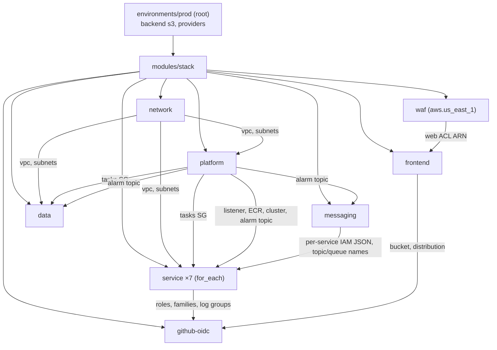

# Phase K: Terraform, AWS Infrastructure, IAM and Deployment Security (Overview)

Scope: `ecommerce-infrastructure/terraform/` (8 modules + 4 environment roots + 8 test suites) on `phase7`,
plus `docs/architecture/deployment.md` and `runbooks.md`. This is a **read-only** explanation. No `terraform`
command was run, and nothing exists in AWS. Only the `local` root has ever been applied (to Floci, by compose's
`messaging-init`). That state file sits git-ignored at `terraform/environments/local/terraform.tfstate`.

| File | Covers |
|---|---|
| **PHASE-K-0-overview.md** (this) | Terraform concepts as this repo uses them, layout, module graph, environment matrix |
| [PHASE-K-1-edge-and-network.md](PHASE-K-1-edge-and-network.md) | VPC, subnets, NAT, VPC endpoints, ALB, security groups, CloudFront, S3, WAF: the request path |
| [PHASE-K-2-compute-data-messaging.md](PHASE-K-2-compute-data-messaging.md) | ECS service module, RDS/DocumentDB, SNS/SQS module, alarms, connection budget |
| [PHASE-K-3-iam-and-secrets.md](PHASE-K-3-iam-and-secrets.md) | Every IAM role and policy, secrets flow, KMS, least-privilege review |
| [PHASE-K-4-state-environments-operations.md](PHASE-K-4-state-environments-operations.md) | State, backends, accounts, the one-time setup, the plan/apply workflow, Terraform commands do/don't, cost drivers |
| [PHASE-K-5-findings-and-exercises.md](PHASE-K-5-findings-and-exercises.md) | Ranked findings K-F1…, fix order, verification, exercises, acceptance criteria |

---

## 1. Terraform in one page (only what this repo uses)

| Concept | What it is | Where you see it here |
|---|---|---|
| **Provider** | Plugin that turns resources into API calls | `hashicorp/aws ~> 6.0`; a second **aliased** provider `aws.us_east_1` for CloudFront-scoped things (WAF; the CloudFront cert must also be in us-east-1) |
| **Resource / data source** | `resource` = something Terraform creates and owns; `data` = something it only reads | `aws_vpc.this` vs `data.aws_ec2_managed_prefix_list.cloudfront`, `data.aws_cloudfront_cache_policy.disabled` |
| **Module** | A reusable folder of `.tf` with inputs (`variable`) and `output`s | `modules/network`, `platform`, `data`, `service`, `frontend`, `waf`, `github-oidc`, `messaging`, and `stack`, which composes them all |
| **Root module** | The folder you run `terraform` in; it has a backend and providers | `environments/{local,dev,staging,prod}` |
| **State** | Terraform's record of which real object each resource address maps to | local file for `local`; S3 (`backend "s3" {}`, partial config via `backend.hcl`) for dev/staging/prod |
| **Lock file** `.terraform.lock.hcl` | Pins provider versions + checksums | committed per environment (6.68.0); **not** committed in module dirs |
| **`count` / `for_each`** | Multiply a resource; `for_each` keys by name, so removing one item doesn't renumber the rest | `for_each = local.services` (7 services), `count = var.az_count` (subnets) |
| **`dynamic` blocks** | Generate nested blocks from a collection | ALB `load_balancer` only for public services; WAF managed rule groups |
| **`validation`** | Reject bad inputs at plan time | `az_count` 2–3, `environment` ∈ dev/staging/prod, `run_as` ≠ root |
| **`lifecycle { ignore_changes }`** | Let something else own an attribute after creation | task definitions (CI owns images), ECS service `task_definition`/`desired_count` (CI + autoscaler) |
| **`default_tags`** | Tags on every resource from the provider | `project`, `environment`, `managed-by = terraform` |
| **`terraform test`** + `mock_provider` | Plan the module against fake AWS responses and assert properties | `modules/*/tests/*.tftest.hcl` (no credentials, no API calls) |

## 2. Layout and module graph

```
terraform/
├── environments/
│   ├── local/   messaging module → Floci (backend "local", fake creds, endpoints → floci:4566)
│   ├── dev/     ┐
│   ├── staging/ ├─ each: backend "s3" {} + providers (region + us-east-1 alias) + module "stack" with a `size` object
│   └── prod/    ┘
└── modules/
    ├── stack/        composes everything for one environment; holds the per-service config map
    ├── network/      VPC, subnets, NAT, VPC endpoints
    ├── platform/     ECS cluster, Service Connect namespace, ALB + listener + block rule, SGs, ECR, alarm topic
    ├── data/         RDS PostgreSQL 17, DocumentDB 5, DB SG, DB alarms
    ├── service/      ×7: task def + migrate task def, ECS service, target group + rules, IAM roles, secret, logs, autoscaling, alarms
    ├── messaging/    SNS topics, SQS queues + DLQs, subscriptions, queue policies, per-service IAM documents, SQS alarms
    ├── frontend/     S3 site bucket, OAC, CloudFront (site + /api/* → ALB), response headers, SPA function
    ├── waf/          WAFv2 web ACL (CLOUDFRONT scope, us-east-1)
    └── github-oidc/  OIDC provider (optional) + one deploy role per repo
```



Read [stack/main.tf](ecommerce-infrastructure/terraform/modules/stack/main.tf) first. Its `locals.services` map
(lines 108–210) is the single place that says, per service: port, public ALB paths, plain env vars, the names of
secret keys, and the container user.

## 3. Environment matrix (from the `size` objects)

| | dev | staging | prod |
|---|---|---|---|
| AZs / NAT gateways | 2 / 1 | 2 / 1 | 3 / 3 |
| PostgreSQL class / Multi-AZ | `db.t4g.micro` / no | `db.t4g.small` / no | `db.m7g.large` / **yes** |
| DocumentDB class × instances | `db.t4g.medium` × 1 | `db.t4g.medium` × 1 | `db.r6g.large` × 2 |
| Backups (days) | 3 | 7 | 14 |
| Tasks per service (min–max) | 1–2 | 1–4 | 2–10 |
| Fargate Spot | yes | yes | no |
| Log retention (days) | 14 | 30 | 90 |
| `protect_resources` (deletion protection, final snapshots) | **false** | true | true |
| GitHub environment | `dev` | `staging` | `production` |
| Creates the GitHub OIDC provider | **yes** | no | no |
| Domain | dev.shop.example.com | staging.shop.example.com | shop.example.com |

Because only dev creates the OIDC provider ("once per AWS account"), **all three environments are designed to
live in one AWS account.** That decision has consequences for blast radius and teardown (PHASE-K-4 §2, finding K-F5).

## 4. Status: designed vs applied

| Thing | Status |
|---|---|
| `environments/local` (messaging → Floci) | **applied** locally by compose (`terraform apply -auto-approve` inside `messaging-init`) |
| dev / staging / prod | **never planned against AWS** (no `backend.hcl`, no credentials). Only `validate` + module `terraform test` with mocks (CLAIM: passing) |
| One-time manual steps (certs, DNS, DB roles, secret values, GitHub environments) | documented in [deployment.md](ecommerce-infrastructure/docs/architecture/deployment.md), not automated |

Keep this in mind throughout Phase K: every finding here is about **what would happen on the first apply**, not about
an observed incident.
