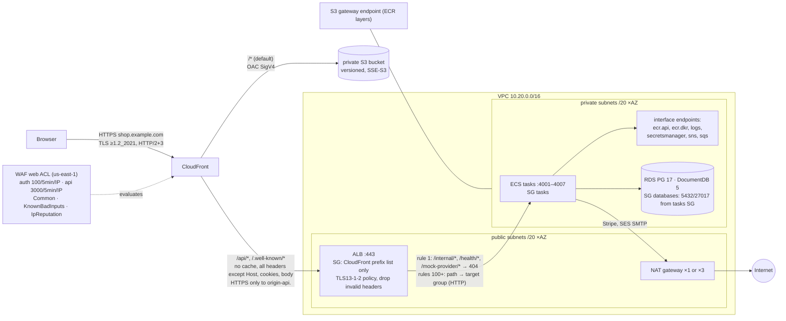

# Phase K-1: The Request Path: CloudFront, WAF, ALB, Security Groups, VPC

## 1. End-to-end path of a browser request (as designed)

## 2. VPC: [modules/network/main.tf](ecommerce-infrastructure/terraform/modules/network/main.tf)

| Element | Code | Why | Alternatives / notes |
|---|---|---|---|
| `/16` VPC split into `/20` subnets with `cidrsubnet(var.cidr, 4, i)` (public 0–2, private 8–10) | lines 41–47 | 4,096 addresses per subnet: Fargate uses one ENI/IP per task, so room to scale | Every env uses `10.20.0.0/16` by default. That is fine while VPCs never need peering; give each env its own range if you might ever peer or use Transit Gateway |
| `map_public_ip_on_launch = false` | line 72 | Nothing in "public" subnets gets a public IP implicitly | Tested |
| `aws_default_security_group` with no rules | 56–60 | Neutralizes the default SG (a classic accidental-allow) | CIS benchmark item |
| NAT: `nat_count = min(nat_gateways, az_count)`, private route tables use `count.index % nat_count` | 46, 113–121 | dev/staging: one shared NAT (cheap; **if its AZ fails, no egress** for Stripe/SMTP). prod: one per AZ | NAT gateways are a significant fixed cost per env; that's why endpoints carry the AWS traffic |
| Interface endpoints `ecr.api, ecr.dkr, logs, secretsmanager, sns, sqs` + S3 **gateway** endpoint | 145–167 | Image pulls, logs, secrets and messaging never leave the VPC or pay NAT data charges. ECR layers live in S3, hence the gateway endpoint | Each interface endpoint is billed per AZ-hour. **No endpoint for**: STS, CloudWatch metrics (`monitoring`), KMS, ECS (not needed on Fargate). Nothing in the code calls those, so it's fine today |
| Endpoint SG: 443 from the VPC CIDR | 130–143 | — | Could be narrowed to the tasks SG |
| **Not present:** VPC Flow Logs | — | — | Needed for network forensics; cheap with S3 + 1-day aggregation (P3) |

## 3. Platform edge: [modules/platform/main.tf](ecommerce-infrastructure/terraform/modules/platform/main.tf)

### Security groups (lines 71–128)

| SG | Ingress | Egress |
|---|---|---|
| `alb` | 443 from managed prefix list `com.amazonaws.global.cloudfront.origin-facing` | 4001–4007 to `tasks` SG |
| `tasks` | 4001–4007 from `alb`; 4001–4007 from **itself** (Service Connect calls) | **all traffic to 0.0.0.0/0** |
| `databases` (data module) | 5432 and 27017 from `tasks` | default |

Observations:
- **One `tasks` SG for all seven services.** Any task can open 4001–4007 on any other task, including other services'
  `/internal/*` routes, and any task can reach both database ports. Isolation inside the VPC relies on **service tokens
  and DB credentials**, not the network. A per-service SG ("only order-service and saga may call payment:4005") is the
  stricter option (P2).
- `tasks_all` egress could be narrowed to 443 (endpoints, Stripe), 587 (SMTP), and the DB SG (P3).

### ALB (lines 131–177)

- `internal = false` in **public** subnets. `drop_invalid_header_fields = true` stops header-smuggling tricks.
  `ssl_policy = ELBSecurityPolicy-TLS13-1-2-2021-06`.
- Default action: a JSON 404 in the platform's problem format. **Rule priority 1** blocks `/internal/*`, `/health/*` and
  `/mock-provider/*` before any service rule (priority 100+). That is the network half of "internal routes never come in
  from outside". The other half is the `service` role check in each service.
- No **access logs** configured (P3; useful for incident analysis and WAF tuning).

### ⚠ The ALB can be reached around your WAF (finding K-F1, CONFIRMED config)

The ALB ingress allows the **CloudFront origin-facing prefix list**. That list contains the addresses of **all**
CloudFront edge servers, used by **every AWS customer's** distributions, not only yours. The origin hostname
`origin-api.<domain>` is in public DNS and has a valid certificate. Anyone can therefore create **their own**
CloudFront distribution with your ALB as its origin:

1. Their request passes the ALB security group (it comes from CloudFront).
2. TLS works (CloudFront validates your certificate for `origin-api.<domain>`, which is valid).
3. The listener rules match on **path only**, not on Host or any secret, so `/api/v1/auth/login` is forwarded.
4. **Your WAF never sees it.** It's attached to *your* distribution. The auth rate limit (100/5 min/IP), the managed
   rule sets and IP reputation are all bypassed. Only the in-memory per-task limits remain, and finding S-2 says why
   those are weak.

[security-review.md](ecommerce-infrastructure/docs/architecture/security-review.md) S-3 marks "clients bypass
CloudFront" as fixed by the prefix list, and the platform test asserts the prefix list. The test passes, but the
control is incomplete.

**Fix options:**
- (a) **CloudFront VPC origins** (an internal ALB in private subnets, reachable only from your distribution). This is the
  strongest option: no public ALB at all.
- (b) **A secret origin header**: CloudFront `custom_header { name = "X-Origin-Verify", value = <random> }` on the
  `api` origin. Then make the ALB listener's default action and every service rule require it: add an
  `http_header` condition to each rule, or put one high-priority "header missing → 403" rule first. Store the value
  in Secrets Manager and rotate it.

Both are standard AWS guidance. Add a `terraform test` assertion for whichever you choose.

### ECR (lines 179–204)

`IMMUTABLE` tags, `scan_on_push`, AES256. The lifecycle policy **keeps the last 30 images of any tag**. Each
deploy pushes two (`<sha>` and `<sha>-migrate`), so the rollback depth is about **15 deploys**, not 30. Interaction
with immutability on reruns: see J-F1 in Phase J.

### Cluster (lines 44–69)

Container Insights `enhanced` (needed for the `RunningTaskCount` alarms), a Service Connect HTTP namespace,
capacity providers `FARGATE` + `FARGATE_SPOT` (default FARGATE; services choose Spot via `use_spot`).

## 4. CloudFront + S3: [modules/frontend/main.tf](ecommerce-infrastructure/terraform/modules/frontend/main.tf)

| Decision | Code | Why it's right | Caveat |
|---|---|---|---|
| **One origin** for shop and API | two origins, `/api/*` + `/.well-known/*` → ALB | No CORS; Auth's refresh/CSRF cookies are first-party (`SameSite=Strict` works) | Locally the stack is multi-origin with CORS (PHASE-A-3), so prod-only behavior exists |
| Private bucket + **OAC** (SigV4), bucket policy limited by `AWS:SourceArn` = this distribution | bucket + policy | The bucket can't be read directly, nor through another distribution | — |
| `BucketOwnerEnforced`, SSE-S3, versioning | — | No ACL surprises; rollback by object version | No lifecycle rule for old versions/assets (cost creep, P3) |
| SPA routing in a **viewer-request CloudFront Function** on the site behavior only | `spa_routes` | An extensionless path becomes `/index.html`. API 404s stay real 404s (not distribution-wide error pages; finding S-4) | A route containing a dot (`/products/v1.2`) would not be rewritten |
| Response headers policy: CSP `default-src 'self' … connect-src 'self' … frame-ancestors 'none'`, HSTS 2 years incl. subdomains, nosniff, DENY, Referrer-Policy, Permissions-Policy | `site` policy | Strong baseline; the build has no inline scripts | Attached to the **site** behavior only. API responses get no HSTS from CloudFront (the browser already has HSTS for the domain, so the impact is low) |
| API behavior: `CachingDisabled` + `AllViewerExceptHostHeader`, all methods, `https-only` to origin, TLSv1.2, read timeout 30 s | — | Nothing personal is ever cached; cookies, `Authorization` and `Idempotency-Key` reach the services | Origin read timeout 30 s < ALB idle 60 s: a slow request is cut at CloudFront first (504) |
| `price_class = PriceClass_200` | — | Includes India edge locations | — |
| **No** CloudFront standard logs | — | — | P3 |

## 5. WAF: [modules/waf/main.tf](ecommerce-infrastructure/terraform/modules/waf/main.tf)

| Rule | Priority | Effect |
|---|---|---|
| `rate-auth`: `uri_path STARTS_WITH /api/v1/auth/` (lowercased), 100 requests / 300 s / IP, **block** | 1 | Shared counter across all tasks and deploys (finding S-2's fix) |
| `rate-api`: `/api/` prefix, 3000 / 300 s / IP, block | 2 | Coarse abuse cap |
| `AWSManagedRulesCommonRuleSet` with `SizeRestrictions_BODY` → **count** | 10 | OWASP-style protections. The body-size rule is relaxed because webhooks and admin product bodies exceed 8 KB |
| `AWSManagedRulesKnownBadInputsRuleSet` | 11 | Log4Shell-style patterns, etc. |
| `AWSManagedRulesAmazonIpReputationList` | 12 | Known-bad IPs |

Real-world cautions:
- **Shared IPs:** mobile carriers (CGNAT, very common in India) and offices put many users behind one IP. 100 auth
  requests per 5 min per IP can block legitimate users at peak. Watch the `rate-auth` metric before tightening, and
  consider a per-account limit in the service (already present) as the primary control.
- **Stripe webhooks** pass through WAF too (same origin). The common rule set's XSS/SQLi body rules have
  false-positive potential on JSON. Run new rule sets in **count** mode first, then switch to block.
- **No WAF logging** configured. Without logs you can't tune or investigate (P3: `aws_wafv2_web_acl_logging_configuration`
  to S3/CloudWatch with redaction of `authorization`/`cookie`).
- All of it is moot for traffic that bypasses CloudFront (K-F1).
