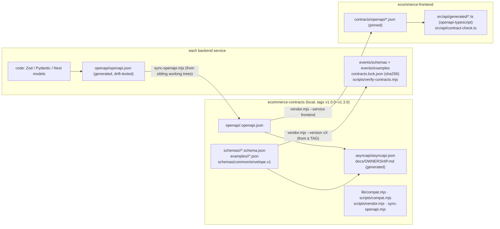

# Phase L: API Contracts: OpenAPI, JSON Schema, AsyncAPI, Compatibility (Overview)

Scope: the `ecommerce-contracts` repository (local only; tags `v1.0.0`–`v1.3.0`, no remote), plus how every
service produces, vendors, validates and tests contracts. Read-only: no tests, `compat`, `vendor` or `sync` command was run
for this analysis. Outputs quoted from [docs/breaking-change-demo.md](ecommerce-contracts/docs/breaking-change-demo.md)
are the project's **own** recorded outputs (CLAIM: real runs).

| File | Covers |
|---|---|
| **PHASE-L-0-overview.md** (this) | Concepts, what lives where, the two contract flows |
| [PHASE-L-1-message-contracts.md](PHASE-L-1-message-contracts.md) | Envelope, command and event schemas line by line; ownership; vendoring + lock; producer and consumer validation |
| [PHASE-L-2-http-contracts.md](PHASE-L-2-http-contracts.md) | OpenAPI per service (code-first), drift tests, the frontend's type checks, backend-to-backend gaps, API versioning |
| [PHASE-L-3-compatibility-and-evolution.md](PHASE-L-3-compatibility-and-evolution.md) | `compat.mjs` rules, version bumps, expand → migrate → contract, deploy-order rules, what can't be detected |
| [PHASE-L-4-findings-and-exercises.md](PHASE-L-4-findings-and-exercises.md) | Findings L-F1…, fix order, exercises, interview questions, acceptance criteria |

---

## 1. Concepts in plain language

| Term | Meaning | In this project |
|---|---|---|
| **Contract** | A promise one side makes to another about the shape and meaning of data | 28 message schemas + 1 envelope + 7 HTTP APIs |
| **JSON Schema (2020-12)** | A JSON vocabulary for "what valid JSON looks like" (types, required fields, patterns, enums) | Every event and command: `schemas/<owner>/*.schema.json` |
| **OpenAPI (3.0 / 3.1)** | JSON Schema for HTTP APIs, plus paths, methods, parameters, status codes and security | `openapi/<service>.openapi.json` (inventory 3.0.0, the rest 3.1.0) |
| **AsyncAPI (3.0)** | OpenAPI's counterpart for messaging: channels (topics/queues), operations (send/receive), messages | `asyncapi/asyncapi.json`, **generated**: 9 channels, 57 operations |
| **Contract-first** | Write the contract, then the code that satisfies it | **Messages**: changed in the contracts repo, released, vendored |
| **Code-first** | Generate the contract from the code | **HTTP APIs**: each service generates OpenAPI from its Zod / Pydantic / Nest models |
| **Tolerant reader** | A consumer validates only what it uses and ignores the rest | event consumers ([parsers.ts](ecommerce-notification-service/src/messaging/parsers.ts) `z.looseObject`) |
| **Strict owner** | The service that *owns* a command validates it fully | command parsers: Ajv with `additionalProperties: false` |
| **Pinning / vendoring** | Copy a specific release's files into the consumer repo with checksums | `events/` + `contracts.lock.json` in each service; `contracts/openapi` in the frontend |
| **Compatibility check** | Decide if a change breaks the other side, and the semver bump it needs | `npm run compat` ([scripts/compat.mjs](ecommerce-contracts/scripts/compat.mjs) + [lib/compat.mjs](ecommerce-contracts/lib/compat.mjs)) |
| **Expand → migrate → contract** | Add the new shape beside the old, move everyone, then remove the old | [VERSIONING.md](ecommerce-contracts/VERSIONING.md) |

## 2. Why this project needs contracts

Seven independently deployed services talk through 28 message types and 7 HTTP APIs. Without contracts, a
field rename in Order would surface as a DLQ full of messages Notification can't parse, or a saga stuck in
`STARTED`, discovered in production. Before Phase 6 the envelope had been copied into six repos by hand and had already
drifted (`$id`), and one schema still named a queue that had become FIFO. The contracts repo's first release
fixed exactly that (CHANGELOG v1.0.0).

## 3. What lives where

**Two flows, deliberately different:**

| | Messages (events, commands) | HTTP APIs |
|---|---|---|
| Source of truth | contracts repo | the service's code |
| A change starts in | a contracts PR (`compat` gates the version bump) | the service repo (its drift test only checks the committed file matches the code) |
| Reaches consumers | when **they** re-vendor a release | backends: never (no backend vendors OpenAPI); frontend: when it re-vendors |
| Compatibility judged | **before** release, in the contracts repo | only when someone runs `sync:openapi` + `compat`, **after** the service may already have shipped (finding L-F1) |

## 4. Release history (from CHANGELOG.md and tags)

| Tag | Content | Bump reason |
|---|---|---|
| v1.0.0 | 25 message schemas, envelope, 7 OpenAPI docs, AsyncAPI, ownership matrix; fixed `OrderStatusTransitionRequested` channel → `order-commands.fifo` | baseline |
| v1.1.0 | payment `Payment.status` / `provider` published as enums | narrowing a **response** = compatible (minor) |
| v1.2.0 | `OrderCancellationRequested`, `InventoryReturnRequested`, `InventoryReturned` | new messages = additions (minor) |
| v1.3.0 | inventory OpenAPI response schemas (previously none) | documenting/narrowing responses (minor) |

Current pins: auth, payment, notification **v1.0.0**; inventory, order, saga **v1.2.0**; frontend **v1.3.0**. A service
needs a newer pin only when it uses something newer, so mixed pins are expected and healthy. The demo branches
`demo/rename-in-place` and `demo/expand-v2` exist locally and were never released.
