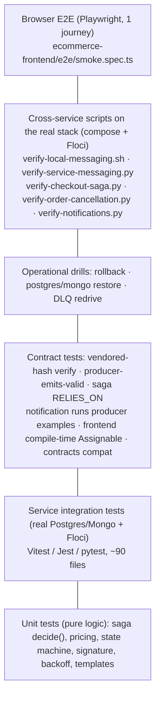

# Phase M: Integration Testing, Observability, Troubleshooting, Production Readiness (Overview)

Scope: every test layer across the ten repos, the cross-service verification scripts and drills in
`ecommerce-infrastructure/scripts/`, logging, health, metrics, alarms, runbooks, and graceful shutdown. Read-only:
**nothing was run**. Drill and script outputs quoted from [runbooks.md](ecommerce-infrastructure/docs/architecture/runbooks.md)
are the project's own recorded local runs (CLAIM).

| File | Covers |
|---|---|
| **PHASE-M-0-overview.md** (this) | The test layers as implemented; what each cross-service script and drill proves |
| [PHASE-M-1-integration-testing.md](PHASE-M-1-integration-testing.md) | Layer by layer: what's covered, what isn't; how to test concurrency, duplicates, webhook retries, saga recovery, migration compatibility |
| [PHASE-M-2-observability.md](PHASE-M-2-observability.md) | Logs, correlation, health checks, metrics, alarms, tracing: what exists, what's missing, a minimal design |
| [PHASE-M-3-troubleshooting-playbook.md](PHASE-M-3-troubleshooting-playbook.md) | Symptom → where to look → queries/commands → fix, local and AWS |
| [PHASE-M-4-production-readiness.md](PHASE-M-4-production-readiness.md) | Readiness scorecard, graceful shutdown analysis, go-live checklist, findings M-F1…, exercises, acceptance criteria |

---

## 1. The testing pyramid as it actually exists

Where each layer runs:

| Layer | Runs in | Automated? |
|---|---|---|
| Unit + service integration | each repo's `ci.yml` (on GitHub `origin/main` today) | yes, per PR / push |
| Contract tests (consumer side) | inside the services' test suites | yes |
| Contracts compat | `ecommerce-contracts` CI | yes, once the repo has a remote |
| Cross-service scripts + Playwright | `ecommerce-infrastructure/.github/workflows/e2e.yml`, nightly | **designed, but cannot run** on your account (repo prefix `cc-`, contracts remote missing, private clones: J-F5/J-F12) |
| Drills | by hand, locally | no (scripts exist) |

## 2. The cross-service scripts: what each one proves

| Script | Checks (from its `check(...)` lines) |
|---|---|
| [verify-local-messaging.sh](ecommerce-infrastructure/scripts/verify-local-messaging.sh) → `.py` | SNS → SQS routing in Floci: each event type reaches exactly the inbox queues its filter policy names |
| [verify-service-messaging.py](ecommerce-infrastructure/scripts/verify-service-messaging.py) | real services publish via their outboxes and consume their command queues |
| [verify-checkout-saga.py](ecommerce-infrastructure/scripts/verify-checkout-saga.py) | 1a–c happy path with a real payment page click and signed webhook; 1b the amount comes from Order; 2 admin refund pending → webhook → REFUNDED; 3 out of stock; 4 decline → release + cancel; 5a payment timeout; 5b **late payment → automatic refund**; 6 **saga SIGKILLed while the payment arrives → resumes → COMPLETED**; 7 forged webhook → 400; 8 all DLQs empty |
| [verify-order-cancellation.py](ecommerce-infrastructure/scripts/verify-order-cancellation.py) | paid order cancel → CANCELLATION_PENDING → refund → REFUNDED → stock returned; another customer gets 404; idempotent repeat; 409 when cancelling again |
| [verify-notifications.py](ecommerce-infrastructure/scripts/verify-notifications.py) | verification email via Auth → Notification (token in the email but **not** in `notification_db`); welcome mail; password reset; order confirmation with total; SMS adapter; **SMTP down → QUEUED with backoff → delivered**; low-stock admin alert; notification DLQs empty |
| [e2e/smoke.spec.ts](ecommerce-frontend/e2e/smoke.spec.ts) (Playwright) | register → buy through the hosted payment page → "Your order is confirmed" → cart emptied → admin marks shipped; **no JWT in local/session storage**; **no CSP violations or page errors** |

These scripts are the most valuable tests in the platform: real processes, real queues, real failure injection (SIGKILL,
SMTP down, forged signatures). Their limitation is **where** they run. They run only on a laptop today, and they target
local compose (Floci, mock payment provider), not AWS.

## 3. Drills (from runbooks.md, recorded locally on 2026-10-15)

| Drill | What it demonstrated | Recorded result (CLAIM) |
|---|---|---|
| `drills/rollback.sh` | a crash-at-startup release detected (readiness 000, restart loop); a command sent meanwhile waits in SQS; rollback; the message is processed exactly once | healthy again after 6 s and 262 s in two runs (the second on a swapping laptop) |
| `drills/postgres-restore.sh` | `pg_dump` → damage → restore into a NEW DB → per-table counts + content hash identical | restore 1 s (tiny dataset) |
| `drills/mongo-restore.sh` | `mongodump` → damage → restore into a new DB, **indexes included** (unique idempotency index) | 3 s |
| `drills/dlq-redrive.sh` | valid command dead-lettered → `start-message-move-task` → processed once; redriven **again** → still one notification | — |

Drills prove the **procedures**, not production timings. Real RTO (recovery time) and RPO (data loss window) must be
measured in staging (point-in-time restore of a real-sized RDS instance takes minutes to hours, not 1 second).

## 4. Headline Phase M findings (details in M-4)

1. **Money-at-risk sagas don't alert anyone.** `MANUAL_REVIEW` emits `SagaManualReviewRequired` to `saga-events`, a topic
   with **no subscribers**. Operators see it only if they open the admin dashboard (M-F1).
2. **No outbox-lag signal.** If a relay stalls (P1-2), no queue gets messages, so the queue-age alarms never fire. Nothing
   measures "oldest unpublished outbox row" (M-F2).
3. **Correlation breaks at every HTTP hop.** Services accept `x-correlation-id` but none sends it on outbound calls. One
   checkout can't be followed by a single id across HTTP + messaging (M-F3).
4. **No application metrics or tracing**: observability is logs plus AWS-native infrastructure metrics only (M-F4).
5. **Graceful shutdown closes the listener immediately** while the ALB still routes for up to its deregistration delay,
   with a 10 s forced exit. That's a likely source of 502s during deploys (M-F5, PLAUSIBLE).
