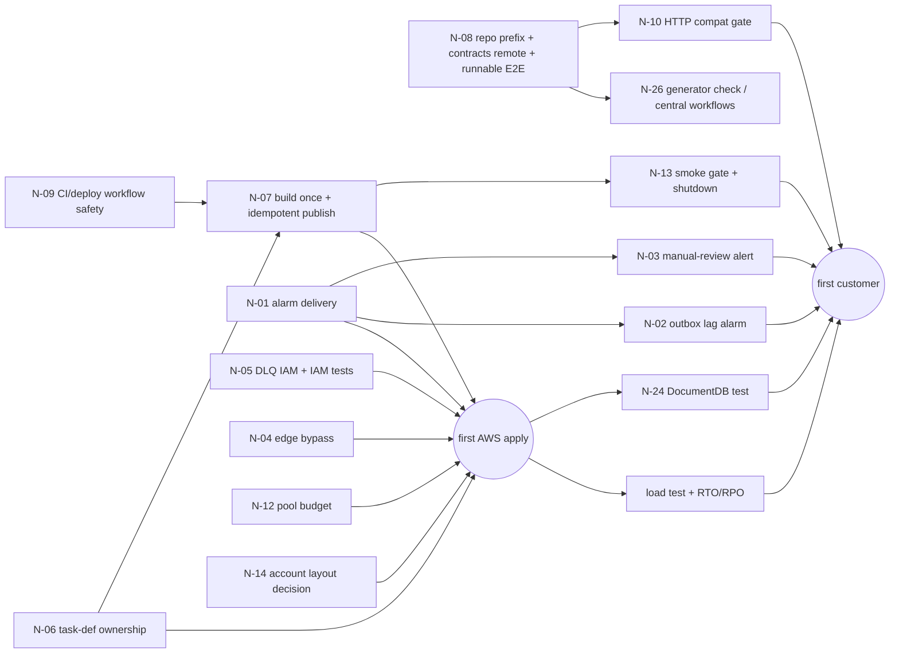

# Phase N-1: Roadmap, Dependencies, Decisions, and Course Wrap-up

## 1. Dependency graph between backlog items

## 2. Milestones (a suggested order; nothing here is scheduled or started)

### Milestone 0: "Safe now" (no AWS, no deploy, can land on `main` even with `phase7` unmerged)
Pure code, CI and docs changes, all testable locally:
- N-02 code part (relay isolation + lag log line + the poison-row test)
- N-09 workflow fixes (template + regenerate), N-19 pins/scanners/Dependabot
- N-15, N-17 small saga/payment fixes with tests; N-16 decide tests (even before changing behavior)
- N-10(b) parse responses in clients; N-20 and N-25 docs; N-08 push the contracts repo
- N-27 migration-compatibility and full-`down` tests

### Milestone 1: "Ready to apply dev" (with your explicit approval, when you choose)
- N-14 account decision → N-01, N-04, N-05, N-06, N-07, N-12, N-22 codified bootstrap, N-31 Terraform constraint
- Then the first `terraform plan` (reviewed) and `apply` in dev; the alarm drill; `simulate-principal-policy` checks; N-24

### Milestone 2: "Ready for customers"
- N-03, N-02 alarm, N-10(a) compat gate, N-13 shutdown + smoke, N-21 minimal metrics + correlation, N-30 guardrails
- Load test in staging; measured RTO/RPO; 7 green nights of E2E; Stripe live-mode check; SES production access

### Milestone 3: "Hardening"
- N-18, N-23, N-21 tracing, N-26, N-28, N-29, remaining P3

## 3. Decisions waiting for you (collected from all phases)

| # | Decision | Options | Affects |
|---|---|---|---|
| 1 | AWS account layout | one account (as designed) vs Organizations with dev/staging/prod accounts | N-14, N-01 keys, state buckets |
| 2 | Edge protection | CloudFront VPC origin (internal ALB) vs a secret origin header | N-04 |
| 3 | Task-definition owner | Terraform (`image_tag` var + TF CD) vs CI (committed template) vs SSM-driven | N-06, N-07 |
| 4 | HTTP compat tool | the project's `compat` lib vs `oasdiff` | N-10 |
| 5 | Alert routing | email only vs Slack/PagerDuty via AWS Chatbot | N-01, N-03 |
| 6 | Tracing | OpenTelemetry + X-Ray vs metrics + logs only | N-21 |
| 7 | In-VPC TLS | accept plain HTTP vs Service Connect TLS | N-18 |
| 8 | GitHub settings | confirm Environments, reviewers, branch protection exist (not visible from the repos) | N-09 |

## 4. How to work through an item safely (process template)

1. Write the **failing test first** (most items have a test described in M-1 §3 or in their card).
2. Make the smallest change that turns it green, in **one repo** where possible.
3. Contracts or IaC involved? Release/plan first and **review the diff/plan**, then deploy owner-first (L-3 §4).
4. Update the doc that described the old behavior (avoid new drift).
5. Verify with the item's "Verify" line. Record the evidence (command output) in the PR.

## 5. Course wrap-up: what you should now be able to do

| Goal (from the master prompt) | Where it was covered |
|---|---|
| Explain each repository and component | A-1, A-6 |
| Trace requests through the code | A-2 (checkout), K-1 (edge → task) |
| Explain why the major patterns were chosen | A-6 (five decisions), L-0 |
| Read CI/CD YAML and every command | J-0 … J-3, J-6 |
| Decide which commands are appropriate where | J-4, K-4 §5 |
| Debug builds, tests, containers, migrations, deployments | J-6, M-3, A-3 §6 |
| Understand SNS/SQS delivery and failure | A-1, A-2 §3, K-2 §3, M-3 §3 |
| Reason about saga, idempotency, compensation | A-2, M-1 §3 |
| Review security and reliability risks | J-5, K-3, A-5, N-0 |
| Understand how independent repos evolve and deploy | J-7, L-1 … L-3 |
| Propose and implement improvements | N-0, this file |

**Phases completed:** A, J, K, L, M, N. **Not yet done:** B (Git workflow, branching, dependencies, configuration,
structure) and the service deep-dives C–I (Auth/Product, Inventory/Order, Payment, SNS/SQS + Notification, Saga, Frontend,
Docker). Phase A covered parts of them at overview level; the deep-dives would go line by line through each service.

## 6. Final acceptance criteria (whole programme)

- Given any N-item, you can explain the problem, show the evidence in the code, and defend its priority.
- You can sequence Milestones 0–2 and explain each dependency arrow in §1.
- You can explain why there is no P0 today, and which P1s become P0 at go-live and why.
- You can explain the "what not to change" list, so a future refactor doesn't break what's already right.
- You can take one Milestone-0 item and describe the test, the change, and the verification without looking at these notes.
